# Software Architecture Description

*Automotive SPICE® PAM v4.0 | SWE.2 Software Architectural Design*

---

## 1. Document Identification & Control

| Field | Value | Field | Value |
|---|---|---|---|
| **Document ID** | ETB-SWE2-001 | **Version** | [latest, §2](#2-revision-history) |
| **Project** | Embedded Test Bench | **Date** | [latest, §2](#2-revision-history) |
| **Status** | [by location, ETB-SUP1-001 §6.3](EmbeddedTestBench_SUP1_Quality_Assurance_Plan.md#63-document-status) | **Classification** | Internal |
| **Author** | Claude | **Reviewer** | Dermot Murphy |
| **Approver** | Dermot Murphy | **Related Process** | SWE.2 |

> **Note — Reviewer independence (ETB-DEV-002):** The Reviewer and Approver are the same person (Dermot Murphy). This is accepted under deviation record **ETB-DEV-002** (`docs/aspice/EmbeddedTestBench_DEV002_Independent_Review_Deviation.md`) on the basis that Embedded Test Bench has a single human team member.

---

## 2. Revision History

| Version | Date | Author | Description of Change |
|---|---|---|---|
| 0.1 | 2026-09-19 | Claude | Initial |
| 0.2 | 2026-09-23 | Claude | DMM-ARC-001 added: the TTi 1604 multimeter element. |
| 0.3 | 2026-09-25 | Claude | AD-23 brought up to date: command documents take variables, connect, timeouts, notes and `<disconnect>`, results are error, skip, fail or pass, and running moved to `script_run.py` (BLE-DD-SCRIPTRUN) (#46, #48). |
| 0.4 | 2026-09-30 | Claude | PICO-ARC-001 added: the Pico 2 + SHT30-D thermometer and its firmware. AD-24 added. Thermometer interfaces added. Header version brought into line with this history (#104). |
| 0.5 | 2026-10-02 | Claude | #115: AD-25 (a key press on the 1604 is confirmed from the readings) and AD-26 (the 1604 is read as a stream, and a measurement is fresh). CORE-ARC-002 gains the stream operations; DMM-ARC-001 updated. |
| 0.6 | 2026-10-02 | Claude | #116: AD-27 (a driver declares which arguments are input files; the runner finds them beside the file that names them). |
| 0.7 | 2026-10-02 | Claude | #126: AD-28 (an event source is an instrument, named by the specification and the bench, not a driver package). |
| 0.8 | 2026-10-03 | Claude | #131: AD-24 (a reading travels with the raw word it came from) marked superseded - the `rd temperature` reply carries no raw word. PICO-ARC-001 updated for the `rd` command set, `ecureset` and the driver's new errors. |
| 0.9 | 2026-10-03 | Claude | #136: RUN-ARC-001 includes the run control channel, bound to 127.0.0.1 only. |
| 0.10 | 2026-10-03 | Claude | #137: VIEW-ARC-001 added - the test run viewer, the top layer above the runner; §5 layering diagram and rule extended to it. |
| 0.11 | 2026-10-03 | Claude | #141: VIEW-ARC-001 may listen beyond 127.0.0.1 with an access token; the runner's control channel stays on 127.0.0.1, so only the viewer is exposed. |
| 0.12 | 2026-10-04 | Claude | #170: "the TestTools checkout" changed to "the EmbeddedTestBench checkout" after the repository rename. The architecture is unchanged. |
| 0.13 | 2026-10-04 | Claude | #183: product renamed to Embedded Test Bench - document file name prefix `EmbeddedTestBench_`, identifier prefix `ETB-` (was `TB-`), product name in prose. Earlier revision rows keep the names in use when they were written. |
| 0.14 | 2026-10-05 | Claude | #204: Review & Approval table points to the merge of the pull request that last changed the document, which is the review and approval (ETB-SUP8-001 §5.7); no per-change signatures or dates. |
| 0.15 | 2026-10-05 | Claude | #194: the compact brand logo added above the title, the same line in every controlled document (ETB-SUP8-001 §6.3). |
| 0.16 | 2026-10-05 | Claude | #60: AD-23 covers BLE-FR-119 - timeouts by command prefix, and the timeout each result reports. |
| 0.17 | 2026-10-25 | Claude | #210: Version and Date in the identification table are links to the last revision history row, which holds them (ETB-SUP8-001 §6.2). |
| 0.18 | 2026-10-25 | Claude | #238: AD-29: device-specific code is a plugin, loaded by path, not part of the package. |
| 0.19 | 2026-10-28 | Claude | #247: SER-ARC-001 added, the serial capture instrument; the layering diagram and the interfaces (the device's serial port, receive only) updated. |
| 0.20 | 2026-11-12 | Claude | #328: PICO-ARC-001 updated for the `wr` command and the three indicator LEDs; the LED GPIO interface added. |
| 0.21 | 2026-11-12 | Claude | #202: merged with #328 (LEDs). PICO-ARC-001: the one `wr` command also stores the frequency generator's settings, read by `rd` and run by `routine`; `fgen` and `cmd_fgen` added. The generator's I2S and GPIO interface added, with the bench wiring. |
| 0.22 | 2026-11-13 | Claude | #202: the frequency generator's I2S interface: an Adafruit UDA1334A board, not a CJMCU-1334, on GP6 (DIN), GP7 (BCLK) and GP8 (WSEL), as the owner rewired it on 2026-11-13. |
| 0.23 | 2026-11-13 | Claude | #330: PICO-ARC-001 names the element the PICO2 Test Board (the Pico 2 SHT30 Temperature Sensor before #330), its class `Pico2TestBoard` and its bench drivers `pico2-test-board` and `pico2`; the event-name example uses the alias `pico2`. |
| 0.24 | 2026-11-13 | Claude | #200: PSCOPE-ARC-001 added, the PicoScope 3000D series MSO driver reached through the `ps3000a` C library with `ctypes`; the layering diagram and the interfaces (USB to the unit, the `ps3000a` library) updated. |
| 0.25 | 2026-11-13 | Claude | #200: the `ps3000a` interface row names its interface specification, ETB-IF-002. |
| 0.26 | 2026-11-13 | Claude | #71: AD-30 added - SEGGER's J-Link Commander and RTT Logger as a second J-Link backend, chosen by configuration; JLINK-ARC-001 names it. |
| 0.27 | 2026-11-14 | Claude | #303: AD-29 consequences - the viewer's device analyses are the Kepler plugin's panel, with its RF tabs and report sections; the viewer names no Kepler field. |
| 0.28 | 2026-11-14 | Claude | #342: PPK-ARC-001 added, the Nordic Power Profiler Kit II driver, and AD-31, the kit driven through its own serial protocol by this project's code; the layering diagram and the interfaces (USB CDC to the kit; power and logic to the device) updated. |
| 0.29 | 2026-11-14 | Claude | #84: AD-32: the S2-LP kit gets firmware of its own, for receiving on the interrupt, with no SLA0072 source; AD-20 stands for the kit on ST's firmware. |
| 0.30 | 2026-11-14 | Claude | #84 (2): AD-20 points to AD-32; S2LP-ARC-001 names the kit firmware. |
| 0.31 | 2026-11-14 | Claude | #84 review round 1: AD-32 trace count 21. |
| 0.32 | 2026-11-14 | Claude | #84 (driver): S2LP-ARC-001 names `kit_firmware`, `kit_driver`, `KitSession` and `SimulatedKitFirmware`; AD-32 - the host driver is `S2lpDevkit`, and its trace adds SWE4-UT-S2LPKITHOST (31) and the driver's bench run. |
| 0.33 | 2026-11-14 | Claude | #84 review round 3: AD-32 trace: SWE4-UT-S2LPKITHOST 31 -> 35. |
| next | 2026-11-17 | Claude | #371: the Status cell links to the status rule, ETB-SUP1-001 §6.3. A document's status follows from where it is in the repository (Released, Agreed, In review, In work) and is not written in by hand. Blank lines that split this table removed. |
| next | 2026-11-17 | Claude | #377: Referenced Documents cite each controlled document at the version of its last numbered revision row, kept by `scripts/doc_versions.py` (ETB-SUP8-001 §6.2). |
| next | 2026-11-17 | Claude | #367: §5 shows the s2lp, gpd3303d and tti1604 packages, the plugin registry and the plugin panels. §10 adds the GPD-3303D, TTi 1604, S2-LP kit and J-Link Commander links. §7.0 added: the evaluation criteria and, for each of AD-01 to AD-32, the alternatives and why they were not taken. §8 is now dynamic behaviour: §8.0 the runner invocation, §8.1 to §8.13 each element's states and timing, with the J-Link rule J1 on GDB's view after `monitor` commands. §9 adds the PSU, DMM, S2-LP, PICO, PicoScope, PPK2 and viewer resources, and corrects the dongle queue to 31 lines. |

---

## 3. Purpose & Scope

### 3.1 Purpose

This document describes the software architecture of **Embedded Test Bench**: the elements it is decomposed into, the dependencies permitted between them, and the decisions that shaped both. It refines ETB-SWE1-001 and is the direct input to detailed design (ETB-SWE3-001).

This document satisfies **Automotive SPICE® PAM v4.0, SWE.2 — Software Architectural Design**.

### 3.2 Referenced Documents

| Document ID | Title | Version |
|---|---|---|
| ETB-SYS2-001 | Embedded Test Bench System Requirements Specification | 0.10 |
| ETB-SWE1-001 | Embedded Test Bench Software Requirements Specification | 1.70 |
| ETB-SWE2-001 | Embedded Test Bench Software Architecture Description | 0.33 |
| ETB-SWE3-001 | Embedded Test Bench Software Detailed Design | 1.90 |
| ETB-RTM-001 | Embedded Test Bench Requirements Traceability Matrix | 1.83 |

---

## 4. Architectural drivers

| # | Driver | Consequence |
|---|---|---|
| D1 | VISA must be optional (STK-06, CORE-NFR-001) | The VXI-11 protocol is implemented in-package, and the choice of protocol stack is pushed behind an abstraction, making it a deployment decision rather than an architectural one. |
| D2 | More instruments are coming (STK-07): power supplies and loads, DMMs, signal sources, logic and protocol analysers, BLE and RF | Everything not specific to one instrument is factored into a shared core. Transports and drivers are held in registries so new ones are added without modifying existing code. |
| D3 | A bench runner must drive the tools (STK-08) | Test intent lives in data, not code. The runner depends on drivers through a uniform base class, never on any specific one. |
| D4 | Cross-channel timing must be trustworthy (ANA-FR-016) | All channels are read from one acquisition; analysis operates on records, never on a live instrument, so it is deterministic and replayable. |
| D5 | Must be verifiable without hardware (SCOPE-FR-090, RUN-FR-005) | A test double sits at the transport boundary — the widest seam that still exercises the SCPI vocabulary — and a simulator harness is shared so each instrument writes only its own behaviour. |
| D6b | Not every bench instrument speaks SCPI (STK-09, and STK-14 to come) | The instrument lifecycle is separated from the SCPI vocabulary: `Instrument` carries connect/initialise/close/identify/simulate, `ScpiInstrument` adds 488.2 and SCPI. The runner depends only on the former, so a debug probe or a BLE dongle is a bench instrument on equal terms. |
| D7 | The probe must be reachable from a container (STK-11, JLINK-NFR-003) | Both links to the probe are TCP: GDB/MI to the J-Link GDB Server and RTT to its RTT port. Nothing in the driver requires the probe to be on the same host, and the driver refuses to spawn a server on a host that is not local. |
| D8 | Timing figures must be defensible (JLINK-FR-065, JLINK-NFR-004) | Timing is a strategy with four implementations of differing resolution and intrusiveness. A result carries its method, its resolution and whether it halted the target, and flags itself when the interval is too small for the method used. |
| D10 | One instrument is partly embedded software (STK-16) | The dongle's firmware and its host driver are one architectural element with one interface artefact, `protocol.h`, that both are built from and that a test parses. The alternative - two elements and a prose protocol - is how firmware and host drift apart. |
| D11 | A radio measurement cannot be timed from the host (STK-14, STK-15) | Timestamps are taken in the dongle's radio event handler on a 1 us clock, and the host's own arrival time is carried beside them as a cross-check rather than as the measurement. USB contributes about a millisecond, which is the same order as a 20 ms advertising interval. |
| D9 | Tests may later be authored in Markdown and run under Robot Framework (STK-12) | The driver boundary returns plain types and dataclasses of plain types, never objects a keyword layer would have to unwrap. Test intent already lives in data (D3), so a translator becomes a front end to the existing runner rather than a second execution engine. |
| D6 | An invalid setting must not half-configure an instrument (CORE-NFR-004) | Validation precedes transmission; a complete setup is sent as one compound message. |

## 5. Layering

```
   +--------------------------------------------------------------+
   |  benchtools.viewer   state  server  static/ (page)           |
   |  plugin panels (from plugins/, loaded by path, AD-29)        |
   +--------------------------------------------------------------+
                        |  event log, control channel
   +--------------------------------------------------------------+
   |  benchtools.runner                                           |
   |  spec -> bench -> runner -> results -> report   +  cli       |
   +--------------------------------------------------------------+
                        |                    |
   +--------------------------------------------------------------+
   |  benchtools.instruments                                      |
   |  tek3014b (scope, constants, simulator, cli)                 |
   |  picoscope3000 (scope, sdk, constants, simulator, cli)       |
   |  ppk2     (ppk2, protocol, measurement, constants,           |
   |            simulator, cli)                                   |
   |  jlink    (probe, gdbmi, session, server, rtt, swo,          |
   |            timing, constants, simulator, cli)                |
   |  nordic_dongle (dongle, protocol, session, profile,          |
   |            latency, constants, simulator, cli)               |
   |  pico2_test_board (thermometer, constants, simulator, cli,   |
   |            flash)                                            |
   |  serial_capture (capture, console, constants, simulator, cli)|
   |  s2lp     (s2lp, protocol, session, registers, traffic,      |
   |            kit_firmware, kit_driver, and others; simulator)  |
   |  gpd3303d (psu, constants, simulator, cli)                   |
   |  tti1604  (dmm, protocol, constants, simulator, cli)         |
   |  generic  (anything answering *IDN?)                         |
   +--------------------------------------------------------------+
              |                                    |
   +-------------------------------+               |
   |  benchtools.analysis          |               |
   |  waveform  measure  plotting  |               |
   +-------------------------------+               |
              |                                    |
   +--------------------------------------------------------------+
   |  benchtools.core                                             |
   |  instrument (Instrument: lifecycle, identity, simulate)      |
   |  scpi (ScpiInstrument, 488.2 blocks)                         |
   |  simulator (SimulatedInstrument, Responder)                  |
   |  enums   validation   errors                                 |
   |  transport: base / vxi11 / socket_raw / visa_backend /        |
   |             process / serial_port / mock / factory (registry)|
   |  plugins (registry of device plugins, AD-29)  events  paths  |
   +--------------------------------------------------------------+
            |                  |                       |
    [ instrument ]   [ J-Link GDB Server ]    [ USB CDC ]
                       |            |               |
                  [ probe ] --- [ target ]   [ dongle firmware ]
                                                    | radio
                                              [ BLE sensor ]
```

Dependencies point one way only: **core, then analysis, then instruments, then
runner, then viewer**. This is not merely a convention — it is enforced by
`tests/test_layering.py`, which parses every module's imports and fails the build
on a violation. The core is additionally checked to contain no reference to any
instrument, and to be importable without importing any other element.

## 6. Architectural elements

| ID | Element | Responsibility | Key interfaces |
|---|---|---|---|
| CORE-ARC-006 | `core.instrument.Instrument` | The instrument lifecycle, independent of command language: open, initialise, close, context manager, cached identity, declared simulator class, overridable event queue. The runner depends on this and on nothing below it. | `connect`, `initialise`, `close`, `identify`, `read_event_queue`, `check_errors`, `SIMULATOR_CLASS` |
| CORE-ARC-001 | `core.scpi.ScpiInstrument` | Extends CORE-ARC-006 with SCPI: command and query primitives, `*IDN?` parsing, IEEE 488.2 operations, `SYSTem:ERRor?` polling, 488.2 block codec. Every SCPI driver subclasses it. | `_command`, `_query`, `_query_float`, `reset`, `parse_ieee_block` |
| CORE-ARC-002 | `core.transport.Transport` | Abstract instrument link with buffered message framing built on three subclass primitives, and stream access for instruments that send without being asked (AD-26). | `write`, `read_message`, `read_exactly`, `read_raw`, `read_available`, `discard_input`, `query`, `clear` |
| CORE-ARC-003 | Concrete transports and the factory | Four interchangeable transports selected by resource string, held in a registry so a new link type registers itself. | `open_transport`, `parse_resource`, `register_backend` |
| CORE-ARC-004 | `core.simulator.SimulatedInstrument` | Shared simulator harness: dispatch, compound messages, 488.2 queries, event queue, binary replies. `Responder` is the protocol the mock transport accepts. | `respond`, `handle`, `_cmd_*`, `push_event` |
| CORE-ARC-007 | `core.firmware` | What a build system recorded about an image, read from the manifest beside it. Here rather than in an instrument because two need it and neither may import the other (AD-22): the dongle reads one to decide whether to refresh itself, the debug probe to say what it just flashed. | `FirmwareBuild`, `MANIFEST_NAME`, `parse_build_date` |
| CORE-ARC-005 | `core.validation`, `core.enums`, `core.errors` | Range and channel validation, the SCPI enumeration base, and the single exception hierarchy. | `validate_range`, `ScpiEnum`, `BenchToolsError` |
| ANA-ARC-001 | `analysis.waveform` | Data model: decode digitiser codes, scale to seconds and volts, detect clipping, export CSV. | `Waveform`, `WaveformPreamble` |
| ANA-ARC-002 | `analysis.measure`, `analysis.plotting` | Pure analysis over `Waveform` objects, and host-side rendering. | `measure_channel_spread`, `measure_period`, `plot_waveforms` |
| INST-ARC-001 | `instruments.*` | One subpackage per instrument, adding only its command vocabulary, capability envelope and simulator. | per `ScpiInstrument` |
| SCOPE-ARC-001 | `instruments.tek3014b` | The TDS3000 SCPI vocabulary and the oscilloscope's capability envelope. | `Tek3014B` |
| PSCOPE-ARC-001 | `instruments.picoscope3000` | The PicoScope 3000D series MSO (#200): four analogue channels, sixteen digital inputs in two ports and a signal generator, captured in one block on one time base. Not a message-based instrument: it has no command text and no transport, and is reached through Pico Technology's `ps3000a` C library. The seam is `sdk`: `Ps3000aSdk` turns each C call the driver uses into a Python method with Python types, and a non-zero status into an exception, and `SimulatedPs3000a` (`simulator`) offers the same methods, so the driver (`scope`), which takes its lifecycle from `Instrument`, cannot tell which it has. The library is found and loaded with `ctypes` only when a unit is opened, so no Pico package is needed and a bare install imports the element. Its records are `Waveform` objects (ANA-ARC-001) in the form the TDS3014B driver returns, so the analysis helpers and a specification take either scope. The facts and capability envelope (`constants`, each value marked measured, spec page or unverified) and a command line. The 3000D MSO has no digital outputs. | `PicoScope3000`, `BlockCapture`, `ChannelSetup`, `ModelLimits`, `Ps3000aSdk`, `find_library`, `SimulatedPs3000a`, `ChannelSignal`, `benchtools pscope` |
| BLE-ARC-001 | `instruments.nordic_dongle` **and** `firmware/nordic_dongle` | The BLE bench dongle, as one element across two languages. Host side: the line protocol (`protocol`), the command/event session with its log (`session`), advertising statistics (`profile`), latency statistics (`latency`), command documents read and run (`script`, AD-23), the driver façade (`dongle`) and a simulated dongle. Dongle side: USB CDC line transport, command dispatch, scanner, UART client and the microsecond clock. `include/protocol.h` is the interface both are built from. | `NordicDongle`, `DongleSession`, `AdvertisingProfile`, `ResponseTiming`, `SimulatedDongle`; `cmd_parser_handle`, `scanner_on_ble_evt`, `nus_client_command` |
| JLINK-ARC-001 | `instruments.jlink` | The debug probe driver. `JLinkProbe` is the façade over seven collaborators, each independently testable: MI record parsing (`gdbmi`), the command/response session (`session`), server discovery and lifetime (`server`), RTT (`rtt`), ITM/SWO decoding (`swo`), timing results (`timing`), and the probe and target envelope (`constants`). Its simulator answers the MI dialogue. A second backend, selected by configuration (AD-30), drives the probe with SEGGER's J-Link Commander and RTT Logger instead (`segger`, `commander`, `simcommander`, `image`). | `JLinkProbe`, `SeggerJLinkProbe`, `GdbMiSession`, `JLinkCommander`, `RttClient`, `ItmDecoder`, `TimingResult`, `GdbServer` |
| S2LP-ARC-001 | `instruments.s2lp` | The ST S2-LP development kit, host side only: ST's firmware runs on the board (AD-20), or the kit firmware in `firmware/s2lp_kit` (AD-32), whichever the board answers as. The line protocol (`protocol`), the command/reply session with its raw log (`session`), the kit firmware's protocol and session (`kit_firmware`) and the driver's side of it (`kit_driver`), the device's register map (`registers`), packet records and their structured log (`packets`), the driver façade (`s2lp`) and a simulated kit with a register file and a modelled air interface. | `S2lpDevkit`, `S2lpSession`, `KitSession`, `Register`, `Packet`, `Capture`, `SimulatedS2lp`, `SimulatedKitFirmware` |
| PSU-ARC-001 | `instruments.gpd3303d` | The GW Instek bench supply, programmable channels 1 and 2; its fixed rail is a front-panel switch and is outside the element. Not a SCPI instrument: it takes the transport and lifecycle from `ScpiInstrument` and replaces the SCPI-specific parts (`*CLS`, `*RST`, `SYSTem:ERRor?`) with its own. Its own command grammar, a load-modelling simulator, and a command line. | `Gpd3303D`, `ChannelReading`, `SupplyStatus`, `SimulatedGpd` |
| DMM-ARC-001 | `instruments.tti1604` | The TTi 1604 bench multimeter, on an opto-isolated RS-232 link. Not a SCPI instrument and not close to one: no command language, no query, no `*IDN?`, no error queue. The link carries single characters standing for key presses, and the meter streams a ten-byte binary frame per measurement. Frame decoding (`protocol`) is pure and separate from the link, because decoding is where a wrong number comes from and it should be testable without a meter. The instrument envelope and protocol facts (`constants`), the driver façade (`dmm`) - which reads the link as a stream (AD-26) and confirms every key press from the readings (AD-25) - a behavioural simulator with the meter's resolution and reading rate on a virtual clock, a command line, an opt-in bench test and a front-panel check. | `Tti1604`, `Reading`, `FrameAssembler`, `decode`, `frame_problem`, `SimulatedTti1604` |
| PICO-ARC-001 | `instruments.pico2_test_board` **and** `firmware/pico2_test_board` | The PICO2 Test Board - a Pico 2 bench thermometer with three LEDs and a frequency generator, named the Pico 2 SHT30 Temperature Sensor before #330 - as one element across two languages. Host side: the driver (`thermometer`, class `Pico2TestBoard`, bench drivers `pico2-test-board` and `pico2`), which takes the transport and lifecycle from `ScpiInstrument` and replaces the SCPI-specific parts with the firmware's `rd` command set (`rd name`, `copyright`, `version`, `sha` and `temperature`, answered `ACK rd <option> = <value>` or `NAK`, #131) and its `wr` command, which switches the three indicator LEDs and is answered with the state read back (`ACK wr <option> = on|off` or `NAK`; the LEDs are also read by `rd`, #328) and also stores the frequency generator's settings, which `rd` reads back and `routine` runs (#202); the protocol tables (`constants`); a simulated thermometer that answers with the firmware's reply text; and a command line. Pico side: line assembly and dispatch (`cmd_parser`), the SHT30 driver (`sht30`), the frequency generator (`fgen`, with its commands in `cmd_fgen`, #202), a bounded text builder in place of stdio (`text`), and a HAL seam (`hal.h`) implemented on the Pico SDK by `hal_pico.c` and by a fake in the host tests. `include/protocol.h` is the interface both sides are built from. | `Pico2TestBoard`, `FirmwareInfo`, `Reading`, `SensorError`, `NoReadingError`, `CommandRefusedError`, `RdRefusedError`, `WrRefusedError`, `SimulatedPico2TestBoard`; `cmd_execute`, `sht30_measure`, `fgen_write`, `fgen_start`, `hal_i2c_write`, `hal_led_set`, `hal_led_get`, `hal_dac_start` |
| SER-ARC-001 | `instruments.serial_capture` | The serial capture instrument, host side only: it records the lines a device prints on a serial port, and writes nothing to it. The driver (`capture`) takes the lifecycle from `Instrument` and reads the port on a thread of its own while a capture runs, so that `ROUTINE START CAPTURE` returns at once; it reopens the port when the line rate or character format changes. The command set (`console`) - `RD`, `WR` and `ROUTINE`, in the Kepler BLE console's reply form (#247) - is a thin layer over the driver's methods, so a specification can use either. Its limits and words (`constants`), a simulated device that prints a script of lines when a capture starts, and a command line. | `SerialCapture`, `CaptureResult`, `CapturedLine`, `Reply`, `execute`, `SimulatedSerialDevice` |
| PPK-ARC-001 | `instruments.ppk2` | The Nordic Power Profiler Kit II (#342): a supply and current meter streaming 100 000 samples a second, with eight logic inputs. Reached over USB CDC through the serial transport, in the kit's own binary protocol (AD-31). The wire format (`protocol`) - commands, the metadata, the calibration and the decoding of each sample into amps and logic levels with Nordic's spike filter - is pure and separate from the link, as the 1604's frame decoding is (DMM-ARC-001). The driver (`ppk2`) takes the lifecycle from `Instrument`, finds the kit by USB serial number, and keeps every sample of a measurement as a `Measurement` (`measurement`), which gives the average, the charge and the pulses with no kit attached. Its facts (`constants`), a simulated kit on a virtual clock, and a command line. | `Ppk2`, `Measurement`, `PulseResult`, `Pulse`, `Calibration`, `SampleDecoder`, `SimulatedPpk2`, `find_ppk2_ports`, `benchtools ppk2` |
| RUN-ARC-001 | `runner` | Specification model, bench resolution, execution engine, result records, report writers, command line, and the run control channel (127.0.0.1 only). | `load_spec`, `BenchConfig`, `BenchRunner`, `write_*` |
| VIEW-ARC-001 | `viewer` | The test run viewer: follows a run's event log, rebuilds the run's state from its structured records, serves a page and JSON API with Server-Sent Events on 127.0.0.1 - or, with an access token and optionally read-only and over HTTPS, on another address (#141) - passes control requests to the runner's control channel, and starts runs as separate processes. The top layer: it may import from every other, and nothing imports from it. | `RunState`, `Hub`, `ViewerServer`, `Launcher`, `Catalogue`, `benchtools view` |

## 7. Key architectural decisions

### 7.0 Alternatives and the criteria that decided them

Added by #367 (SWE.2.BP3). Each row takes its alternatives from
the decision's own text where it states them. Where the decision states none,
the row names the alternative the decision rules out, and says so with
"(not recorded in the decision)".

**Evaluation criteria.**

- **C1 Reproducible:** the same specification gives the same result on any rig and from any directory.
- **C2 Runs without hardware:** the element can be run and tested against a simulator, in CI.
- **C3 No mandatory third-party dependency:** a bare install of the package needs nothing beyond the standard library (CORE-NFR-001).
- **C4 Timing attributable:** a time figure carries the clock that made it and that clock's resolution.
- **C5 Honest results:** nothing is lost silently, nothing reports success while doing nothing, failure is kept apart from error, and simulation is disclosed.
- **C6 Containerisable:** the bench can move into a container without USB pass-through (STK-11).
- **C7 Vendor licence:** no vendor source is redistributed, and no licence stricter than the package's own is brought in.
- **C8 One source of truth:** each fact is written once, in data a reviewer can read without reading code.
- **C9 Safe bench state:** the driver cannot leave the device under test at a voltage or wiring the operator did not set up, and the safe state can always be reached.
- **C10 Extensible:** a new instrument or link type is added without changing existing code (D2).

| Decision | Alternatives considered | Criteria that decided it | Why the alternative was not taken |
|---|---|---|---|
| AD-01 VXI-11 in-package | Depend on a VISA runtime (a VISA library with `pyvisa`) for every LAN instrument. | C3, C6, C7 | A VISA library is a heavyweight, platform-specific and sometimes licensed dependency on every test host. VXI-11 is an open protocol; `pyvisa` stays as an optional backend (§10). |
| AD-02 Shared core, layering enforced by a test | Self-contained drivers, each with its own transport, SCPI and simulator code; or layering kept by convention only (not recorded in the decision). | C10, C8 | About half of the first driver was instrument-agnostic, so with six more families it would be duplicated six times. Convention alone had already let `transport/mock.py` import the oscilloscope's simulator. |
| AD-03 Registries for transports and drivers | If-chains in the factory and the runner that name each transport and driver (not recorded in the decision). | C10, C8 | A new link type would mean editing the chain. A registry also lets a bench name a driver as data, so a specification cannot reach arbitrary code. |
| AD-04 Framing primitives in the base transport | Each transport implements `read_message`, `read_exactly` and `read_raw` itself (not recorded in the decision). | C8 | The three framing modes are the same on every transport and only "end" differs. Writing them once removes the most likely place for transports to diverge. |
| AD-05 Binary blocks read by declared length | Read `CURVe?` to the terminator or end-of-message (not recorded in the decision). | C5 | Binary sample data can contain the terminator byte, and a raw socket has no end-of-message at all. |
| AD-06 N-channel timing on the host from one acquisition | Use the oscilloscope's two-source `DELay` measurement N-1 times. | C4, C5 | N-1 measurements come from different acquisitions, so they measure the instrument's repeatability as much as the skew. |
| AD-07 Poll for acquisition completion | Wait on `*OPC?`. | C5 | On the TDS3000 family, `*OPC?` returns when the command is parsed, not when the acquisition finishes. |
| AD-08 Test intent as data, separate from the bench | Bench tests written as scripts; or the instruments written into the specification (not recorded in the decision). | C8, C1, C2 | Scripts hide the limits from the test engineer who reviews them. A specification tied to one rig cannot run unchanged on another rig or against simulators. |
| AD-09 Failure and error are distinct | One pass/fail outcome per step (not recorded in the decision). | C5 | It would turn a broken rig into a pile of apparent product defects, and hide the real ones. |
| AD-10 A simulated run is always disclosed | Flag a run as simulated only when `--simulate` is given (not recorded in the decision). | C5 | A bench made only of simulators would then give a report with simulated numbers that reads as hardware evidence. |
| AD-11 Lifecycle separate from SCPI | Make the probe a `ScpiInstrument` with stubbed SCPI; or a separate `Probe` hierarchy beside `ScpiInstrument`. | C5, C10 | Stubs would put lies in the type. A second hierarchy would force the runner to know which kind of instrument it holds. |
| AD-12 J-Link through the GDB Server and GDB/MI | The `JLinkARM` DLL through `ctypes`; `pylink-square`; the server's telnet/`monitor` interface on its own. | C3, C6, C8 | The DLL has no symbol knowledge, has to be shipped per platform, and is a native library inside a container. `pylink-square` is a third-party dependency with no DWARF reader. Why telnet alone was not taken is not stated; it is kept for probe operations MI lacks. |
| AD-13 Both links to the probe are TCP | USB pass-through of the probe into the container, with J-Link software in the container (not recorded as an alternative; the context calls pass-through "awkward and host-specific"). | C6 | USB pass-through is host-specific. Over TCP the container needs neither USB access nor J-Link software. |
| AD-14 Four timing methods, each with its resolution | Pick one method; or choose the method automatically. | C4, C5 | One method would make the driver unusable on some targets. Choosing automatically would hide which method ran, and with it the resolution the number should be read at. |
| AD-15 Plain types at the driver boundary | Return live handles and objects, and write glue for each driver in a keyword layer; or take a Robot Framework dependency now (not recorded in the decision). | C3, C10 | A keyword layer would have to unwrap driver objects one by one. Plain types cost nothing if the Robot path is never taken. |
| AD-16 Dongle firmware and driver are one element | A separate `FW-` element with its own documents; Nordic's `ble_connectivity` firmware with `pc-ble-driver-py`. | C8, C4 | A separate element doubles the paperwork for one interface. The stock firmware puts the BLE stack on the host side of USB, so every timestamp carries USB jitter. |
| AD-17 Timestamps taken in the dongle, host times kept beside them | Timestamp each event on the host when it arrives; or keep only the dongle's time (not recorded in the decision). | C4, C5 | Host arrival carries about 1 ms of USB and scheduling jitter, the same order as a 20 ms advertising interval. Without the host figure, a slow sensor cannot be told from a busy host. |
| AD-18 Filter in the firmware, count in both places | Send every report and filter on the host; or drop lines without counting them (not recorded in the decision). | C5 | A busy room gives hundreds of reports a second, more than USB and the host keep up with. A silent drop looks like a sensor that skipped a beacon. |
| AD-19 Emulated per-channel output, stated everywhere | Expose only the supply's global switch; or emulate per-channel output and hide it. | C9, C5 | Global-only makes a two-rail test drive both channels as one. Hiding the emulation invites someone to use `output_off` as an interlock, though a channel off this way is at 0 V, not open circuit. |
| AD-20 ST's firmware on the S2-LP kit | Firmware of this project's own, following the dongle's precedent (AD-16). | C7, C2 | Register access, transmit, receive and logging are already in ST's firmware, and reimplementing them makes none more accurate. Own firmware would add a build, a flashing step and a licence question. AD-32 later reverses this for interrupt receive. |
| AD-21 Refuse a write the tracking supply would discard | Pass the write through and report the mode; cache the mode at connect; send `TRACK<n>`. | C5, C9 | Passing through is a command that seems to succeed and changes nothing (D-30, D-31). The mode is a front-panel switch a person can move between two commands. `TRACK<n>` could put a board across two channels in series. |
| AD-22 Values carried between steps | Write the identifier and version into the specification; allow arbitrary expressions. | C5, C8 | Written-in values make the test assert its own input: it passes against the wrong board and goes stale on a rebuild. Expressions would make a reviewer read code. |
| AD-23 The command-set document is the test | A specification step that iterates a table; Robot Framework. | C8 | A table step puts the commands back in the specification in a second format. Robot is undecided (CON-06, OPEN-04) and not needed for a document a test engineer maintains. |
| AD-24 (superseded by #131) A reading carries its raw word | Converted values only; raw words only, converted on the host. | C5 | When decided: converted values alone hide a conversion defect, and raw words alone make the reply unreadable in a terminal. #131 replaced this decision with the fixed `ACK rd` reply. |
| AD-25 A 1604 key press confirmed from the readings | Trust the key's echo. | C5 | The echo is wrong in the cases that matter: a toggle resent after a lost echo, a key refused with a beep, a front panel changed by hand. The meter has no query to read its state. |
| AD-26 The 1604 read as a stream; each measurement fresh | A reader thread keeping the latest frame; timestamping frames on arrival. | C5, C1 | A thread in every process that opens a meter saves only 0.4 s. A frame that waited in the operating system's buffer arrives late and looks new. |
| AD-27 A driver declares its input files | Resolve every string that names an existing file; a base directory parameter per driver; change the working directory to the specification's. | C1 | The first rewrites an output path or a channel name that matches a file. The second fixes one driver only. The third moves every output file. |
| AD-28 An event source is a named instrument | Keep the driver table and append the alias; name by alias alone; find the owner from the call stack. | C5, C8 | The first leaves transports unlabelled. The second renames every log when a role is renamed. The third breaks across threads and cannot be seen by a reader. |
| AD-29 Device code is a plugin, loaded by path | Python entry points; device code kept in `benchtools` behind a registry. | C1, C8 | Entry points need the product installed as a package, and record a package version, not the commit the results were read with. A registry still leaves product code in the bench. |
| AD-30 SEGGER tools as a second J-Link backend | Drive `JLinkARM.dll`; one long-lived Commander process; RTT through Commander's telnet port; Nordic's `nrfjprog`. | C3, C2, C7 | The DLL is rejected for AD-12's reasons. A long-lived Commander needs a prompt-driven dialogue that cannot be checked without a probe, and RTT over telnet needs that process too. `nrfjprog` is not SEGGER's, and it is nRF-specific. |
| AD-31 PPK2 driven by this project's code | Depend on `ppk2-api` (IRNAS); drive Nordic's Power Profiler app. | C7, C3, C2 | `ppk2-api` is GPL-2.0 and brings its own threads and buffering in place of the transport and simulator seam. Nordic's app is a desktop program with no remote interface. |
| AD-32 The S2-LP kit gets firmware of its own | Keep ST's firmware (AD-20); change ST's firmware. | C4, C5, C7 | ST's receive is armed per packet from the host and is deaf for 26-27 ms (#293), against 20 ms between Kepler repeats (#84). ST's source is under SLA0072, which forbids publishing it, and this repository is public. |


### AD-01 — Implement VXI-11 rather than depend on VISA
*Decision:* implement the ONC-RPC/VXI-11 core channel on the standard library.
*Rationale:* VXI-11 is an open published protocol; a VISA library is one
implementation of it. Implementing it removes a heavyweight, platform-specific,
sometimes licensed dependency from every test host.
*Cost:* ~320 lines of protocol code that must itself be verified — addressed by
testing against an independently written RPC server and cross-checking against
pyvisa-py.

### AD-02 — A shared core with enforced one-way dependencies
*Decision:* factor the transport, SCPI plumbing, validation and simulator harness
into `benchtools.core`, and enforce the layering with a test.
*Rationale:* roughly half of the original single-instrument driver was already
instrument-agnostic. With six more instrument families planned, that code is
either shared once or duplicated six times.
*Consequence:* a specific coupling had to be broken. `transport/mock.py`
previously imported the oscilloscope's simulator, so the entire transport package
— and therefore every future driver — depended on one oscilloscope. The mock
transport now accepts any `Responder`, and each driver declares its own simulator
via `SIMULATOR_CLASS`. The dependency is inverted: instruments know about the
core, never the reverse.

### AD-03 — Registries, not if-chains, for transports and drivers
*Decision:* transports, resource schemes and instrument drivers are registered by
name.
*Rationale:* BLE and RF instruments will need link types that are not SCPI over
LAN — serial dongles, USBTMC, HTTP-controlled boxes. A registry lets those arrive
in their own modules. It also means a bench configuration names a driver as data,
so a test specification cannot reach arbitrary code.

### AD-04 — Framing primitives in the base transport
*Decision:* subclasses supply `_recv_chunk() -> (data, end)`; the base builds
`read_message`, `read_exactly` and `read_raw`.
*Rationale:* the three framing modes SCPI needs are identical across transports;
only the notion of "end" differs. Writing them once removes the most likely place
for transports to diverge.

### AD-05 — Read binary blocks by declared length, not to end-of-message
*Decision:* `CURVe?` responses are read by consuming the IEEE 488.2 header and
then exactly the declared number of bytes.
*Rationale:* binary sample data can legitimately contain the terminator byte, and
a raw socket has no end-of-message indication at all.
*Consequence:* the payload returned is already de-framed and must **not** be
passed through the block parser again — `Waveform.from_payload` exists for
exactly this, distinct from `from_block`. A defect of precisely this kind was
found and fixed during development; see the test report.

### AD-06 — N-channel timing analysis host-side, from one acquisition
*Decision:* the spread measurement captures all channels from a single
acquisition and computes edge times on the host.
*Rationale:* an oscilloscope's `DELay` measurement takes two sources, so an
N-channel spread would need N-1 sequential measurements over different
acquisitions — which measures instrument repeatability as much as signal skew.
*Consequence:* correctness depends on the record being unclipped, which is why
clipping detection is a requirement rather than a nicety.

### AD-07 — Poll for acquisition completion rather than `*OPC?`
*Decision:* acquisition completion is detected by polling the instrument's busy
indication.
*Rationale:* on the TDS3000 family `*OPC?` returns when the command is parsed,
not when the acquisition finishes.

### AD-08 — Test intent as data, separated from the bench
*Decision:* the runner takes a declarative specification (what to do, what counts
as a pass) and a separate bench configuration (which instruments, where).
*Rationale:* limits and intent stay reviewable by a test engineer and trace
directly to a requirement, which is the reason for not writing bench tests as
scripts. Separating the bench makes a specification portable across rigs and
runnable against simulators unchanged.
*Consequence:* the runner needs a generic way to address a value inside a driver's
return type, which is `runner.resolve`. This is the price of the decision and is
confined to one small module.

### AD-09 — Failure and error are distinct throughout
*Decision:* a measurement outside its limit is a *failure*; a step that could not
execute is an *error*. The distinction is carried through result records, the
markdown report and JUnit XML.
*Rationale:* conflating them turns a broken rig into a pile of apparent product
defects, and hides real ones.

### AD-10 — A run against simulators is always disclosed
*Decision:* a run is flagged simulated when `--simulate` is used *or* when no
instrument on the bench is real hardware, and every report says so.
*Rationale:* a report is evidence. Simulated numbers presented without that
qualification would be read as hardware measurements.

### AD-11 — The instrument lifecycle is separated from the SCPI vocabulary

**Context.** `ScpiInstrument` carried both the lifecycle every driver needs
(connect, initialise, close, identify, simulate, check errors) and the SCPI
specifics (`*IDN?`, `*CLS`, `SYSTem:ERRor?`, 488.2 blocks). The runner depended on
that class, so "bench instrument" meant "SCPI instrument".

**Decision.** Split it. `core.instrument.Instrument` holds the lifecycle and knows
nothing of any command language; `ScpiInstrument` subclasses it and adds SCPI. The
runner's driver registry is typed on `Instrument`.

**Consequences.** A debug probe is a bench instrument without pretending to speak
SCPI — no stub `*IDN?`, no empty error queue implementation. The BLE dongle and the
RS-232 multimeter to come will need exactly the same seam. The cost is one more
class in the hierarchy, and identity parsing moving to the SCPI layer where it
belongs: `InstrumentIdentity.from_idn()` is IEEE 488.2, so it is not in the generic
constructor, and a non-SCPI driver populates the fields itself.

**Alternatives rejected.** Making the probe a `ScpiInstrument` with stubbed SCPI
would have put lies in the type. A separate `Probe` hierarchy alongside
`ScpiInstrument` would have forced the runner to know which kind it holds.

### AD-12 — Drive the probe through the J-Link GDB Server and GDB/MI

**Context.** Three ways to reach a J-Link: the `JLinkARM` DLL through `ctypes` (or
`pylink-square`), the server's telnet/`monitor` interface, or the GDB Server with a
GDB speaking the machine interface.

**Decision.** GDB/MI through the J-Link GDB Server, with `monitor` commands for the
probe-specific operations that have no MI equivalent.

**Consequences.** Symbolic operations — a breakpoint at `sensor.c:75`, the value of
`sensor_mv`, a call stack with file and line — come from GDB's DWARF reader, which
is the requirement (JLINK-FR-041, -045) and is a large amount of code not to write.
Both links are TCP, which is what makes D7 achievable. MI is a stable, documented,
versioned interface, unlike the DLL's ABI. The costs: two processes to manage
instead of none, an MI parser to write and test (`gdbmi`, 37 tests), and asynchronous
records that can arrive at any moment — handled by draining the transport before
each command rather than discarding whatever is buffered.

**Alternatives rejected.** The DLL is the shortest path to memory and flash but has
no symbol knowledge, would have to be shipped per platform, and is a native library
inside a container. `pylink-square` is a third-party dependency (CORE-NFR-001,
JLINK-NFR-001) and still has no DWARF reader.

### AD-13 — Both links to the probe are TCP, so the bench containerises

**Context.** The whole bench is to move into Docker (STK-11), but a probe is a USB
device and USB pass-through into a container is awkward and host-specific.

**Decision.** The driver reaches the probe only over TCP: GDB/MI to the GDB Server's
port and RTT to its RTT port. `jlink://host:port` attaches to a server anywhere. The
driver spawns a server only when the target is local, and refuses otherwise with a
diagnostic saying so.

**Consequences.** The container needs no USB access and no J-Link software: the
server runs on the machine the probe is plugged into — which is also the Windows PC
of the first deployment — and the container connects to it. Nothing has to change
when the bench is containerised, which is why this decision is taken now rather
than then. The cost is that a stale server on the expected port is used rather than
replaced; this is deliberate, since a server the driver did not start is also a
server it must not kill (JLINK-FR-005).

### AD-14 — Four timing methods, each reporting its own resolution

**Context.** "Measure the time between two lines of code" has no single correct
implementation. A cycle counter is exact but halts the core; the host clock works
anywhere but resolves milliseconds; SWO does not halt but needs trace wiring; a
target timer is exact but needs firmware cooperation.

**Decision.** Implement all four behind one call with a selectable method. Every
result carries the method, the resolution of that method, whether it halted the
target, and a `is_trustworthy` flag that is false when the interval is not at least
an order of magnitude above the resolution.

**Consequences.** The caller chooses the trade-off knowingly, and a measurement can
never be quoted without the means by which it was obtained (JLINK-NFR-004). This is
an evidence-integrity property, not a convenience: the host-clock method returns
about 93 µs for a 1 ms interval in the simulated bench, and the flag is what stops
that figure being read as a measurement.

**Alternatives rejected.** Picking one method would have made the driver unusable on
some targets. Choosing automatically would have hidden which one ran, and with it
the resolution the number should be read at.

### AD-15 — Plain types at the driver boundary, for a keyword layer later

**Context.** Tests may be authored in Markdown and translated to Robot Framework
(STK-12). Robot keywords exchange strings and simple values.

**Decision.** Every probe operation returns a plain type or a dataclass of plain
types — `VerifyResult`, `FlashResult`, `HaltInfo`, `StackFrame`, `TimingResult` with
`as_dict()`. No operation returns a live handle the caller must manage, and every
one is reachable through the declarative runner's dotted method paths.

**Consequences.** A Robot keyword library, or a Markdown translator, is a thin front
end over the same runner; neither needs driver-specific glue. The CLI already
demonstrates it by emitting JSON. No Robot dependency is taken in this revision, so
the decision costs nothing if that path is not followed.

### AD-16 — Firmware and driver are one element with one interface artefact

**Context.** The dongle needs custom firmware: nothing off the shelf timestamps
an advertising report at the radio and reports it over USB in a form a test can
assert on. That makes part of this item embedded C, in a different language and
a different build, changed by different tools.

**Decision.** Treat the dongle firmware and its host driver as **one**
architectural element (BLE-ARC-001), with `firmware/nordic_dongle/include/protocol.h`
as the sole definition of what passes between them. The firmware builds its
command table from that header; the host driver mirrors it in `constants.py`;
and `test_firmware_protocol.py` parses the header and fails the build if the two
disagree about a command, an event, an error code or a size limit.

**Consequences.** A command added to one side and forgotten on the other is a red
test rather than "unknown command" at a bench six weeks later. The firmware also
comes under the same traceability rules as the Python: every C file carries its
`Traces to:` line, and the same test checks that, that no file allocates
dynamically, and that the house indentation holds. The cost is that the header
must stay free of anything that is merely an internal firmware choice - hence
`app_ble_config.h` beside it for the things the host has no business knowing.

**Alternatives rejected.** A separate `FW-` element with its own document set
would double the paperwork for one interface. Nordic's stock `ble_connectivity`
firmware with `pc-ble-driver-py` on the host would have removed the firmware
entirely, but it puts the BLE stack on the *host* side of the USB link, so every
timestamp would carry USB jitter - which is precisely the measurement this
element exists to avoid (AD-17).

### AD-17 — Timestamps are taken in the dongle, and the host's are kept beside them

**Context.** An advertising interval is 20 ms to 10 s; a connection interval is
7.5 ms to 4 s. USB polling plus host scheduling contributes roughly a
millisecond, with millisecond-scale jitter.

**Decision.** Every event carries `t=`, a microsecond timestamp taken in the
dongle's radio event handler from a TIMER peripheral, extended to 64 bits. The
host records its own arrival time in the `Event`, and every latency result
carries a `LatencySource` saying which clock produced it.

**Consequences.** Interval statistics are about the sensor. The host figures are
kept, not discarded, because the difference between the two *is* the overhead of
the host link, and a bench that cannot see that overhead cannot tell a slow
sensor from a busy host. `ResponseTiming.is_trustworthy` is false when a figure
is inside the connection interval, for the same reason the J-Link driver flags a
figure inside its clock's resolution (AD-14): a number that cannot be
distinguished from the instrument's own floor is not a measurement of the thing
under test.

### AD-18 — Filter in the firmware, count in both places

**Context.** A busy room produces hundreds of advertising reports a second. The
USB link and the host both have limits, and dropping reports silently would show
up as a sensor that skipped beacons.

**Decision.** Address and name filtering happen in the firmware, before anything
is sent. The firmware counts what the radio delivered and what it managed to
send; the host counts what it received. `AdvertisingProfile.is_complete`
compares them, and a profile computed from a lossy stream says so.

**Consequences.** A missed advertising event can be attributed to the sensor
rather than the plumbing - or explicitly cannot be, which is the honest
alternative. The firmware's outgoing queue drops whole lines and counts them
rather than truncating one, because half a line would be a parse error in the
host and would look like a protocol fault rather than congestion.

### AD-19 — Emulate per-channel output, and say so at every turn

**Context.** The GPD-3303D has one output switch for two channels. A bench
specification, and every other supply driver, wants per-channel control.

**Decision.** The driver presents `output_on(channel)` and
`output_off(channel)`, implemented by programming the channel to zero volts and
remembering its setpoint. The supply's real switch is opened only when *every*
channel has been switched off, so "all off" means off. The emulation is stated
in the method's own docstring, in the command line's output, and in the notes:
a channel switched off this way is at 0 V with its current limit unchanged, not
open circuit.

**Alternatives.** Exposing only the global switch would have been the most
honest interface and the least usable one: a two-rail test would have to drive
the two channels as one. Hiding the emulation entirely would have been usable
and dangerous - somebody would eventually use `output_off` as an interlock.

**Consequences.** A channel that is "off" will still sink current from a board
powered by something else, and cannot be used as a safety measure. In exchange,
a specification written against this supply reads like one written against a
two-channel supply, and the one place the abstraction leaks is documented
wherever a caller will meet it. The parked setpoint is driver state, not
instrument state: a second program talking to the same supply does not know
about it, which is why the driver reads the hardware rather than its own
bookkeeping wherever the hardware can answer.

### AD-20 — Use the vendor's firmware where the vendor already provides one

**Context.** The S2-LP development kit is driven by ST's GUI through firmware ST
ships for it: a CLI application over the kit's USB serial port, with commands for
SPI register access, radio configuration, transmit and receive. The BLE dongle in
this repository has firmware of our own (AD-16), so the precedent pulled the
other way.

**Decision.** Use ST's firmware unchanged, and write only the host driver. The
firmware's command set becomes an **external interface** to this project rather
than something it controls: it is written down in `constants.COMMANDS`, and every
command the driver sends is checked against it.

**Why this is not AD-16.** The dongle's firmware exists because a radio event
must be timestamped on the radio's side of a USB link, and no stock firmware did
that. Here the requirement is register access, transmit, receive and logging -
all of which ST's firmware already does, and none of which is made more accurate
by being reimplemented. Writing firmware would have added a build, a flashing
procedure, a licence question and a second thing to keep in step with the
datasheet, in exchange for nothing the measurement needs.

**Consequences.** The kit works with the firmware it arrives with, and with ST's
GUI, and nothing has to be flashed before a bench session. In exchange this
element inherits the firmware's limits and cannot fix them: reception is polled,
so the radio is deaf between calls; timestamps are the motherboard's
millisecond timer; and the command set is what it is. The driver's job is
therefore to be **honest about those limits** rather than to hide them - hence
the re-arm count carried in every capture (S2LP-FR-033) and the millisecond
resolution stated wherever a board timestamp is reported.

AD-32 adds the kit's own firmware, for receiving on the interrupt; this decision
still holds for the kit when it runs ST's firmware.

**Licence.** ST's package is under SLA0072, a limited licence, not a permissive
one. Interoperating with the protocol is not redistribution; vendoring the
source would be. No ST source is in this repository, and the register map holds
facts about the silicon rather than vendor prose (S2LP-NFR-002).

### AD-21 — Refuse what a tracking supply would discard, rather than report it

**Context.** The GPD-3303D's front panel selects independent, series or parallel
tracking. In series and parallel the supply drives CH2 from CH1 and **accepts
and discards** anything addressed to CH2: no error, nothing in `STATUS?`, and
`VSET2?` answering with CH1's setting. The same is true of the emulated
per-channel switch of AD-19, which is built on programming a channel to zero.

**Decision.** The driver reads the mode at the moment of the write and raises
for a setpoint or per-channel switch addressed to the slaved channel, naming the
mode and what to do instead. Channel 1 is untouched - it is the master in both
modes - and the global switch and the safe state stay operable in every mode,
because a safe state must never be unreachable. A mode the status word does not
decode is warned about and allowed: the bit order is a confirmation item
(PSU-OPEN-01, PSU-OPEN-06), and one unconfirmed bit should not leave the driver
unable to set anything. `TRACK<n>` is never sent: which rails are tied together
is a wiring decision, and changing it from a test script could put a board
across two channels in series at twice the voltage the operator set up.

**Alternatives.** Reporting the mode and passing the write through was the
previous behaviour, inherited from the two-channel GPD-2303S where it was
harmless. It is the exact shape of D-30 and D-31: a command that appears to
succeed and changes nothing. Caching the mode at connect was rejected because it
is a switch a person can move between two commands.

**Consequences.** A specification written for independent operation fails
immediately and legibly on a supply someone left in series, instead of
configuring a rail that was never configured. The cost is one `STATUS?` query
before each write to the slaved channel, which is 50 ms on a paced link, and
only on that channel.

### AD-22 — A specification carries values between steps rather than repeating them

**Context.** The first test of a bench session is a chain: power the board,
program it, read the identifier the part was programmed with at manufacture,
find that board over the air by it, and confirm it reports the version that was
just flashed onto it. Until now a step's result could be saved and nothing could
read it, so every one of those facts would have had to be written into the
specification.

**Decision.** `save:` keeps a step's result; `{from: <name>}` takes it in any
later step, as an argument or as a limit, with an optional `format` template for
when the thing on the wire is a rendering of the value rather than the value
(RUN-FR-016). Limits gained exact comparison against text, because a version and
a device name are not numbers (RUN-FR-024), and the reader of a build manifest
moved into the core so the debug probe can say what it flashed without importing
the dongle (CORE-FR-050, CORE-DD-FIRMWARE).

**Alternatives.** Writing the identifier and the version into the specification
was the alternative, and it fails in a specific way: the test asserts its own
input. It passes against the wrong board, because the identifier it looks for is
the one it was told to look for; and it goes stale silently the day someone
rebuilds the firmware. Letting a specification carry arbitrary expressions was
rejected for the reason specifications are data at all (AD-08): a reviewer must
be able to read one without reading code.

**Consequences.** A chained test states relationships between facts the bench
establishes, rather than restating constants. The cost is that a reference
cannot be checked when the specification is loaded - what `build.version` refers
to does not exist until that step has run - so an unresolvable reference is a
run-time error, and it names every value that *has* been saved.

### AD-23 — The document that specifies a command set is the test of it

**Context.** A sensor's command set is written down long before anyone tests
it. Turning that document into a test means copying the commands into a
specification, which makes two things that must agree - and they stop agreeing
the first time someone adds a command to one of them. STK-12 asked for tests
that come from a markdown document; CON-06 deferred the general question of
adopting Robot Framework for it.

**Decision.** The driver reads the document directly
(BLE-DD-SCRIPT, BLE-DD-SCRIPTRUN, BLE-FR-100 … -116, -119): a heading per test, a
table of step number, command and expected response, with optional timeout and
note columns, variables, and timeouts by command prefix. Running it produces a
result per row - what was sent, what came back, what was expected, how long the
exchange took, how long it could have waited and why, the result and a note -
and an event log; a run is in error when a step errored, fails when
a step failed, and passes otherwise. Reading lives in `script.py` and running in
`script_run.py`, so each stays a size one person can read. The specification that runs
it is four lines, and holds no commands at all.

**Alternatives.** A new construct in the specification language - a step that
iterates a table - was rejected because it puts the commands back in the
specification, in a second format. Robot Framework remains undecided (CON-06,
OPEN-04) and is not needed for this: what STK-12 wanted here was a document a
test engineer maintains, not a framework.

**Consequences.** The document is maintained by whoever owns the command set,
and the test follows it without a code change. In exchange the document must be
strict about its own shape - an unreadable row is refused naming the line,
because a row skipped quietly is a command nobody tested and nobody missed - and
the three step kinds must stay distinguishable in the report: a step that was
skipped must never read as one that passed, which is why a run states how many
steps it checked as well as how many passed.

### AD-24 — A reading travels with the raw word it came from

> **Superseded by #131.** The decision below is no longer in force and is kept
> as a record. The user fixed the bench protocol as
> `ACK rd <option> = <value>`, so `rd temperature` carries the temperature to
> two decimal places and no raw word, and the driver can no longer recompute it
> (PICO-FR-044 withdrawn). The integrity of a reading now rests on two things:
> the driver accepts only a value in the exact two-place format and refuses
> anything else (PICO-FR-027, -047), and a failed reading is answered `Error`,
> which the driver raises as `NoReadingError`, while an unknown option is
> answered `NAK`. A conversion defect in the firmware is caught by the reference
> vectors shared between the C and Python tests, not at run time.

**Context.** The thermometer's value crosses two conversions and a USB link:
the sensor's 16-bit word becomes milli-degrees in the firmware, text on the
wire, and a float on the host. A defect in any of them - an overflowed
multiplication, a sign lost in formatting, a corrupted line - produces a number
that is plausible, and a plausible temperature is the hardest kind of wrong
value to notice.

**Decision.** `temp` reports the raw words beside the converted values
(PICO-FR-022). The host driver recomputes each value from its word with the
firmware's own integer arithmetic (`constants.raw_to_celsius`) and refuses a
reply in which they disagree (PICO-FR-044). A reading that fails on the sensor
side is an `err` reply with a code, never a value (PICO-FR-021, -023), and the
driver raises for it (PICO-FR-043).

**Alternatives.** Reporting the converted values alone is shorter on the wire,
and leaves the host unable to tell a conversion defect from a warm room.
Reporting only raw words and converting on the host was rejected because the
firmware's own reply would then not be readable in a terminal, which is how the
board is first brought up.

**Consequences.** The conversion is specified twice, in C and in Python, and
must agree bit for bit; the simulator and both test suites use the same
reference vectors so that a change to one side fails a test on the other. The
reply is 20 characters longer than it needs to be.

### AD-25 — A key press on the 1604 is confirmed from the readings, never from its echo

**Context.** The TTi 1604 is controlled by sending the characters of its
front-panel keys. Each is echoed, and the host must resend a key whose echo does
not arrive within 300 ms. Some keys toggle - Auto/Man for certain - and an echo
can be lost after the meter acted on the key, so resending is not idempotent. A
key the meter refuses with a beep (Hz on a DC range) is echoed all the same.

**Decision.** The echo is used to pace keys: it says the meter heard a
character. Whether the meter *did* what was asked is taken from the readings it
streams, which carry the function, range, coupling and annunciators. Every
`select_*` and range operation presses its keys and then waits, within a
bounded time, for a reading showing the state asked for, and raises naming what
the readings show if none does (DMM-FR-029, -030). Nothing is pressed for a
state the readings already show, so auto-ranging is set, not toggled.

**Alternatives.** Trusting the echo is simpler and wrong in exactly the cases
that matter: a toggle resent after a lost echo, a refused key, a front panel
changed by hand. The meter has no query to read its state back any other way.

**Consequences.** A function change costs one to two seconds, most of it the
meter's own, and the frame decoder carries the burden of being right - it is
tested against frames built from the manufacturer's note, not only from the
simulator. With remote mode declined there are no readings, and keys are
pressed unconfirmed.

### AD-26 — The 1604 is read as a stream, and a measurement is fresh

**Context.** In remote mode the 1604 sends a frame after every measurement,
2.5 times a second, whether or not anyone is reading; nothing it sends ends a
message. The driver read with `Transport.read_raw()`, which waits for an
end-of-message a serial port never signals: on a real port every read timed
out with the bytes left unread, and connecting always failed (#115). Separately,
the operating system keeps what nobody read, so the next frame on the line can
be minutes old, and frames carry no timestamp.

**Decision.** The core gains a stream read, `read_available()`, which returns
whatever has arrived and waits only when nothing has, and `discard_input()`,
which empties the transport's buffer and the operating system's (CORE-FR-061).
The driver reads with a fixed short timeout that it never varies, because
pyserial on Windows loses bytes whenever the timeout changes (LL-07), and loops
to its own deadline. A measurement discards everything received, then one more
frame, and returns the next (DMM-FR-031). Waits allow for the meter's reading
rate in its present state, including the 10 s frequency gate (DMM-FR-032). A
simulator on a virtual clock is given the read timeout (CORE-FR-062), so a wait
shorter than the meter's fails in the tests.

**Alternatives.** A reader thread keeping the latest frame would make a
reading instant, and put a thread in every process that opens a meter for a
saving of 0.4 s. Timestamping on arrival does not help: a frame that sat in the
operating system's buffer arrives late and looks new.

**Consequences.** A measurement costs 0.4 - 0.8 s, and a frequency measurement
on the 4 kHz range up to 20 s. Any instrument that speaks without being asked
can use the two transport operations.

### AD-27 — A driver declares its input files; the runner finds them

**Context.** Specifications and bench files name the files a driver reads - an
S2-LP register file, a command document, a firmware build, an ELF image - by a
relative path, and every driver opened it as given, so relative to the working
directory. The runner is normally started in the repository of the firmware
under test, and from there the Kepler, radio-link, BLE and bring-up
specifications all errored before measuring anything (#116).

**Decision.** A driver marks the arguments of its methods that name a file to
be read with `@input_paths(...)` (CORE-DD-PATHS). Before calling a method, the
runner resolves the marked arguments of a step against the specification's
directory (RUN-FR-017); before connecting an instrument, the bench resolves the
marked options of `connect` against the bench file's directory (RUN-FR-007).
Each searches the declaring file's directory, then the working directory, then
the EmbeddedTestBench checkout. The mark lives in the core so every element can apply it
without importing the runner.

**Alternatives.** Resolving every string argument that happens to name an
existing file would rewrite an output path, or a channel called `CH1`, whenever
a file of that name was lying beside the specification. A per-driver base
directory parameter, as first proposed for the S2-LP, would fix one driver and
leave the dongle and probe broken. Changing the working directory to the
specification's would move every output file.

**Consequences.** Any shipped specification gives the same result from any
directory. A driver that adds a file argument must mark it, and
`TestEveryDriverDeclaresItsInputFiles` pins the current set. A file beside a
specification takes precedence over one of the same name in the working
directory.

### AD-28 — An event source is an instrument, named in the setup, not a driver package

**Context.** The event log labelled each record from a fixed table of driver
packages: `gpd3303d` was `psu`, `jlink` was `jlink`, anything else `bench`. The
Pico 2 thermometer was not in the table, so its records read `bench`; two
instruments of one driver - `probe` and `rtt`, or two supplies - could not be
told apart; and the shared transports' lines were `bench` whatever instrument
they carried. The name was a property of the code, not of the bench (#126).

**Decision.** A record carries the short upper-case name of the *instrument* it
came from. A specification allocates it to an instrument role
(`pico2: {driver: pico2-test-board, event: TEMP}`), a bench attaches it to an actual
instrument (`event: TEMP`), and the specification's wins; with neither, the
driver's default (`Instrument.EVENT_SOURCE`) applies. Each instrument holds its
name in one `EventSource`, and binds everything it owns - transport, sessions,
RTT client, GDB Server - to it through a `SourceLogger`, so a rename reaches all
of them. The bench builds the instrument inside `connecting_as(name)`, so
opening the link and identifying are named too. Two instruments a run uses may
not share a name, defaults included.

**Alternatives.** Keeping the driver table and appending the alias would still
leave the transports unlabelled and give no control over the name. A name taken
from the alias alone would change every log whenever a specification renamed a
role. Inspecting the call stack for the owning instrument would need no driver
change, and would be fragile across threads and invisible to a reader.

**Consequences.** Every driver logs through `self._logger` rather than a module
logger; a new driver gets this from `Instrument`. Names are upper case: a log
written before #126 is lower case, and the monitor reads both. A specification
that uses `probe` and `rtt` together must name one of them, which the shipped
benches do (`event: RTT`).

### AD-29 — Device-specific code is a plugin, loaded by path

**Context.** The bench decoded Kepler's radio frames, held Kepler's S2-LP
register file and showed a Kepler viewer panel, all inside `benchtools`. The
owner decided that Kepler content belongs in the Kepler repository and is loaded
from there, so the bench carries no product code of its own (#238).

**Decision.** A device plugin is a folder holding a Python package with a
`register(plugin)` function, loaded by path (`benchtools.core.plugins`). It
provides decoders, register files, viewer panels, field names and named hooks.
A bench file or specification lists the folders it needs (`plugins:`), and the
command lines take `--plugin`. Actions take a decoder by name. Every report
records each plugin's folder and git commit.

**Alternatives.** Python entry points would need the product's code installed
as a package in the bench's environment, and would record a package version
rather than the commit the results were read with. Keeping the code in
`benchtools` behind a registry would leave product code in the bench.

**Consequences.** Kepler's code is in `plugins/kepler` until it is hosted in
innovateuk-sensor and #240 removes it. The simulated Kepler sensor stays in
`benchtools/simulated` until #119 and #240. The viewer's device analyses
(sensor series, TWF, diagnostics, sync, the report's sections) are the Kepler
plugin's panel since #303: the panel lists its RF tabs, and gives its report
sections as data that the viewer draws, so nothing under `benchtools/viewer`
names a Kepler field. A plugin runs with the bench's permissions, so only a
folder the operator names is loaded: the viewer does not load the plugins named
in a log it follows, and says which they are. For one release, a specification
written before #238 (`kepler_samples`, `kepler_frame`, the old register file
path, no `plugins:`) loads the checkout's Kepler plugin with a deprecation
warning, so the Kepler repository's specifications keep running until they
name the plugin; #240 removes the fallback with the plugin.

### AD-30 — SEGGER's own tools as a second J-Link backend, chosen by configuration

**Context.** AD-12 drives the probe through the J-Link GDB Server and an ARM
GDB. That needs a GDB installed, which the bench PC did not have, and it
carries GDB's own faults (issue #69). The same PC has SEGGER's J-Link Commander
and RTT Logger, with which the bench's erase, flash, UICR write, reset and RTT
sequence was done before #69. A bench that needs only those has had to install
GDB anyway (#71).

**Decision.** A probe option `backend`: `gdb`, the default and AD-12
unchanged, or `segger`. `segger` runs one J-Link Commander command file per
operation and reads RTT with J-Link RTT Logger. It is a subclass of
`JLinkProbe`, so a bench registers and checks it as the same driver; every
operation that needs symbols or a debugger is refused by name before anything
reaches the probe. What #69 taught is kept on both: an erase is checked by
reading back, a write is read back, the core is left running on close, and
each result records the backend that produced it. Nordic's `nrfjprog` is not
part of it: it is not SEGGER's, and it is nRF-specific.

**Alternatives.** Driving `JLinkARM.dll` directly is rejected for the reasons
AD-12 gives. One long-lived Commander process fed commands on its input would
keep a core halted between operations, but needs a prompt-driven dialogue that
cannot be checked without a probe; one run per operation is simpler and leaves
no session behind a failure. Reading RTT through Commander's telnet port needs
that long-lived process too.

**Consequences.** Commander's syntax was read from the installed binary's own
strings, not run against a probe (ETB-RISK-004); the `segger` backend is
verified on the simulator only until its bench check. The image is read on
the host (`image`), so verification is per range rather than per section
name. RTT is read only. Whether a core halted by one Commander run stays
halted after it exits is not known.

### AD-31 — The PPK2 is driven through its own serial protocol, by this project's code

**Context.** The Power Profiler Kit II (#342) is a USB CDC device with a small
binary protocol: one opcode per command, a metadata text, and a stream of
32-bit samples. Nordic publishes no Python library for it. Nordic's Power
Profiler app (`pc-nrfconnect-ppk`, TypeScript, Nordic's own 4-clause licence)
is the authority on the protocol. `ppk2-api` (IRNAS) is an unofficial Python
library, licensed GPL-2.0.

**Decision.** The driver speaks the protocol itself, over the project's serial
transport (CORE-ARC-002). The protocol facts - opcodes, the sample word, the
calibration formula and the spike filter - were read from Nordic's app and are
written down in `constants`, `protocol` and `docs/ppk2/PPK2_Notes.md`; no code
was copied from either project. The samples are kept as read and decoded after
sampling stops, so decoding never holds up reading a 400 kB/s stream. The
driver changes nothing on the kit when it connects, and `voltage_limit`, from
the bench file, caps the voltage it will set or power a device on at.

**Alternatives.** Depending on `ppk2-api` would bring a GPL-2.0 dependency
into a package with none, and its own threads and buffering in place of the
project's transport and simulator seam. Driving Nordic's app is not possible:
it is a desktop program with no remote interface.

**Consequences.** The protocol is followed as Nordic's app uses it, not from a
specification Nordic publishes; where the bench kit behaved otherwise it is
recorded (it answers its metadata once per open, and goes off USB for under a
second each time its port closes). A change in the kit's firmware would be
found by the bench check, not by the unit tests, which run against the
simulated kit.

### AD-32 — The S2-LP kit gets firmware of its own, for receiving on the interrupt

**Context.** AD-20 kept ST's CLI firmware on the S2-LP kit. Its receive is
armed from the host one packet at a time, so a stream that reads PQI and SQI
after each frame is deaf for the round trip: 26-27 ms measured (#293), while
the Kepler sensor spaces its repeats from 20 ms (#84). Changing ST's firmware
is not open to this project: its CLI and S2-LP driver are under SLA0072,
which forbids publishing them, and this repository is public.

**Decision.** Write the kit's firmware here (`firmware/s2lp_kit`), with no ST
source: its own startup, linker script, STM32L053 register definitions and
S2-LP SPI access. It takes each reception on the radio's interrupt, queues it
on the board with its time and registers, and re-arms the radio before
anything goes to the host. The radio's setup stays the host's, as register
writes. AD-20 still holds for the kit when it runs ST's firmware: the existing
driver is unchanged.

**Consequences.** The kit has to be flashed to use it, and flashed back for
ST's GUI and for the existing driver; ST's image is kept outside the
repository. The firmware is built and unit-tested in CI like the dongle's and
the PICO2 Test Board's. Configuring the radio by its ST commands
(`S2LPRadioInit` and the like) is not available on it: a register file is the
way to set it up. The host driver is `S2lpDevkit` itself: it asks which
firmware the board runs on connecting and changes session, so a caller of
`stream` does not change (S2LP-FR-098 .. S2LP-FR-100).

AD-32 → `SWE4-UT-S2LPKITFW` (21), notably `test_a_frame_is_queued_with_time_and_registers_then_rearmed` and `test_the_longest_deaf_time_is_kept`; `SWE4-UT-S2LPKITHOST` (35), notably `test_the_kit_firmware_is_found_by_asking` and `test_frames_with_their_registers_and_decode`; and the bench runs in `docs/aspice/qualification/2026-11-14/84_kit_firmware/` and `84_kit_driver/`.

---

## 8. Dynamic behaviour

### 8.0 A runner invocation

```
CLI            BenchRunner        Bench           Tek3014B        Transport
 |                  |               |                 |                |
 |- load_spec ----->|               |                 |                |
 |- load_bench ---->|               |                 |                |
 |- run(spec) ----->|               |                 |                |
 |                  |- require() -->|  (fail fast if an alias is absent)
 |                  |   setup steps:                  |                |
 |                  |- get("scope")->|- connect() --->|- open() ------>|
 |                  |- configure_channel(...) ------->|- write ------->|
 |                  |   per test, per step:           |                |
 |                  |- measure_channel_spread() ----->|- acquire,      |
 |                  |                                 |  capture,      |
 |                  |                                 |  analyse       |
 |                  |<- (waveforms, SpreadResult) ----|                |
 |                  |- resolve_path("1.spread")       |                |
 |                  |- Limit.check(scaled)            |                |
 |                  |   teardown steps, then close    |                |
 |<- RunRecord -----|- close() ----->|- close() ----->|- close() ----->|
 |- write_json / write_markdown / write_junit          |                |
```

Added by #367 (SWE.2.BP2). §8.0 shows one runner invocation.
These views add each element's behaviour over time. A state diagram appears
only where the code holds the state, and names the class or variable that
holds it. Where a phase sequence runs inside one call with no state kept, the
element has a table only. Paths are relative to `benchtools/` or `firmware/`.
A number is given only where the code or the notes give it.

### 8.1 CORE transports (CORE-ARC-002, -003)

Source: `core/transport/base.py`, `vxi11.py`, `socket_raw.py`, `serial_port.py`, `process.py`, `mock.py`.

`Transport._is_open` holds the state. `open()` and `close()` can both be called
again safely, and `close()` never raises. There is no "connecting" or "failed"
state: a failed open raises, and the transport stays closed.

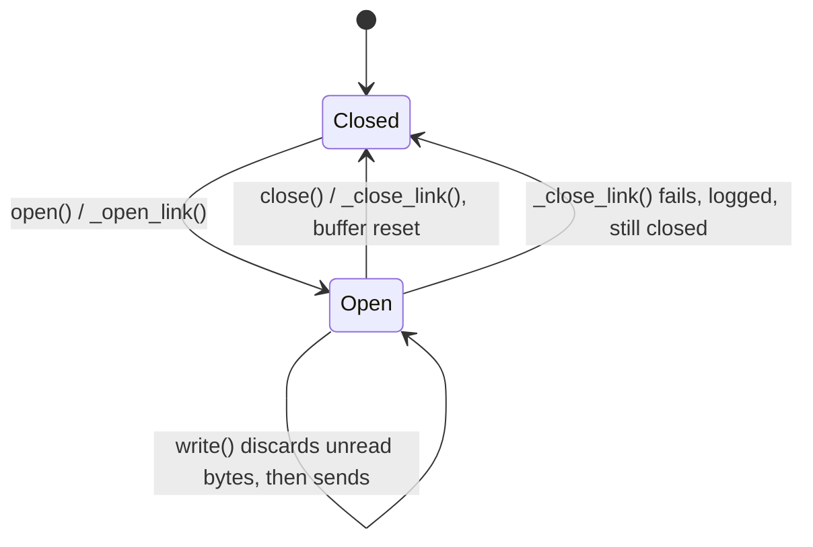

| Phase | What moves it | Timing that matters |
|---|---|---|
| Message read | `read_message()` fills until the read terminator or END | Each fill waits up to the transport timeout, default 10.0 s (`base.py`). An empty fill raises `TransportTimeoutError`. A reply over `MAX_RESPONSE_BYTES` (64 MiB) raises. |
| Stream read (AD-26) | `read_available()` returns whatever is buffered, and waits only when nothing is | Waits up to the timeout. `discard_input()` also empties the operating system's buffer on serial. |
| VXI-11 link | `_open_link`: portmapper (TCP, then UDP), then `create_link` for each device name in turn; `_close_link`: `destroy_link` | Lock timeout 5.0 s. `max_recv_size` is what the instrument offers, bounded to 512 B .. 1 MiB, else 4096. Error 4 (invalid link) clears the link and raises `ConnectionFailedError`. |
| Raw socket read to end | `read_raw()` | The first chunk may take the full timeout. After that it stops at `idle_gap` = 1.0 s of quiet. |
| Serial | `_recv_chunk` reads 1 byte, then what is waiting | The pyserial timeout is changed only when the value changes, because pyserial on Windows loses bytes when it is reassigned (LL-07). No pacing in the core; drivers pace (PSU). |
| Process (GDB child) | `open()`: `Popen`, then two daemon reader threads | `ready_timeout` 0.5 s catches a child that exits at once. On close: `terminate`, wait 2.0 s, then `kill`, wait 2.0 s; threads joined with 1.0 s each. |

### 8.2 Plugin loading (AD-29)

Source: `core/plugins.py`, `Registry.load`.

There is no state field. A plugin is loaded if it is in `REGISTRY.plugins`.
After a failure, its modules are removed from `sys.modules`.

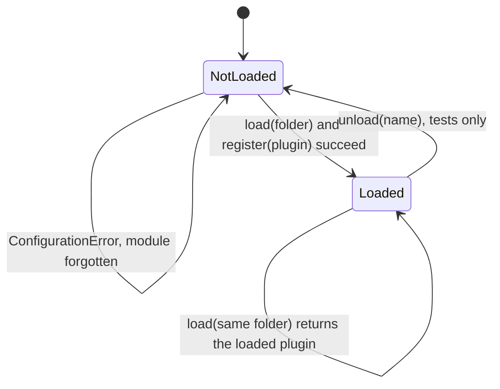

| Step | What happens | Timing that matters |
|---|---|---|
| 1. Folder | Path normalised. A folder already loaded returns its plugin. `__init__.py` is required. | none |
| 2. Import | Imported as `etb_plugins.<name>_<sha1[:10]>` from the folder | none |
| 3. Name | `NAME`, else the folder name. A second plugin of the same name is refused. | none |
| 4. Commit | `git rev-parse HEAD` and `git status --porcelain` give `ref` and `dirty` | Each git call has a 10 s timeout |
| 5. Register | `register(plugin)`. A decoder name already taken by another plugin is refused. | none |
| Pre-#238 fallback | `ensure_legacy_kepler` loads `plugins/kepler` with a deprecation warning, before `run_start` so the run records it | none |

### 8.3 PSU-ARC-001, GPD-3303D

Source: `instruments/gpd3303d/psu.py`, `constants.py`.

Two kinds of state change over time. Each channel is either live or parked,
held as a key in `Gpd3303D._parked`. The supply's one output switch is held in
the supply itself, and the driver reads it from `STATUS?` rather than keeping it.

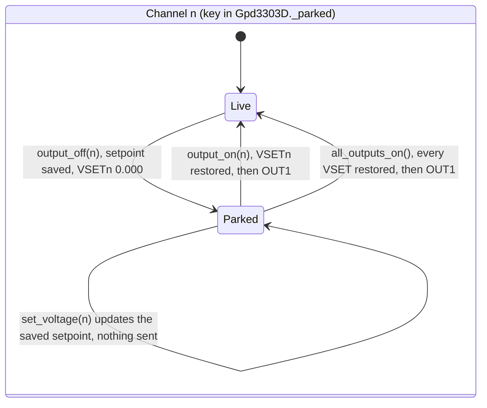

When every channel is parked, `output_off` also sends `OUT0`. `all_outputs_off`
sends `OUT0` and leaves `_parked` as it is. `_post_open` and `reset` clear
`_parked`.

| Behaviour | What moves it | Timing that matters |
|---|---|---|
| Command pacing | `_pace` before every `_write` and `_query` | At least `DEFAULT_COMMAND_INTERVAL` = 0.05 s between commands on a real link, and 0 on `sim`, `loop://` or `mock`. Measured latency: `VSET?` and the like take 17-30 ms; `STATUS?` takes about 143 ms to the last byte at 9600 baud (ETB-IF-001). |
| Tracking check (AD-21) | `_check_tracking(2)` before any setpoint or per-channel switch on channel 2 | One live `STATUS?` each time, never cached. Series or parallel raises `ConfigurationError`. An undecoded mode warns and goes ahead. |
| Safe state | `reset(settle=0.2)`: `VSET1:0.000`, `VSET2:0.000`, `OUT0`, `_parked` cleared | 0.2 s settle. Current limits are left as they are. Outputs fall to 0 V in 2-3 s with no load (ETB-IF-001). |
| Connect | `_post_open` identifies the supply and reads its status, and changes nothing | `connect(timeout=5.0)`. A missing status legend line costs one timeout. |

### 8.4 DMM-ARC-001, TTi 1604

Source: `instruments/tti1604/dmm.py`, `protocol.py`, `constants.py`.

`Tti1604._remote` holds the meter's remote mode. `remote()` sends `u` and
`local()` sends `v`. In remote mode, every key press is confirmed from the
readings (AD-25). Outside it, keys are pressed unconfirmed.

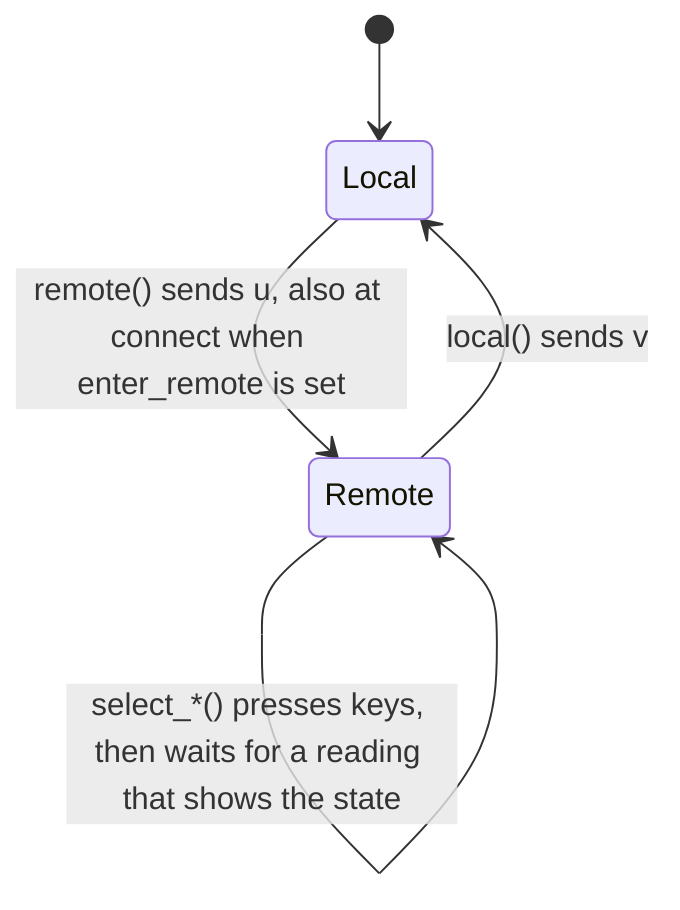

`FrameAssembler` keeps no named states, only a frame buffer, a residue (the
echoes) and a `resynchronised` count.

| Phase | What moves it | Timing that matters |
|---|---|---|
| Key press | `_send_character`: write the key, then wait for its echo | `ECHO_TIMEOUT` 0.3 s, three sends at most, then `InstrumentError`. |
| Confirmation | `_await` waits for a reading showing the state asked for | `max(CONFIRM_TIMEOUT 4.0 s, _patience())`. `_patience` is `SETTLING_TIME` 2.0 s, or in Hz 2.0 s + 2 x gate = 4.0 s or 22.0 s. |
| Reading stream | Meter sends one 10-byte frame per measurement | `READING_INTERVAL` 0.4 s (2.5/s). The read timeout is fixed at `READ_POLL` 0.05 s and never varied; the driver loops to its own deadline. |
| Measurement (AD-26) | `measure()`: discard everything, read and drop one frame, return the next | 0.4-0.8 s (TTi1604_Notes §6.5). A blank reading is read again for up to `RANGING_TIME` 6.0 s. Frequency gate 10 s on the 4 kHz range, 1 s on 40 kHz. |

### 8.5 PICO-ARC-001, PICO2 Test Board

Source: `firmware/pico2_test_board/src/cmd_parser.c`, `fgen.c`, `sht30.c`, `hal_pico.c`; `instruments/pico2_test_board/thermometer.py`, `flash.py`.

**Firmware line assembly** (`cmd_line_push`, results in `cmd_parser.h`):

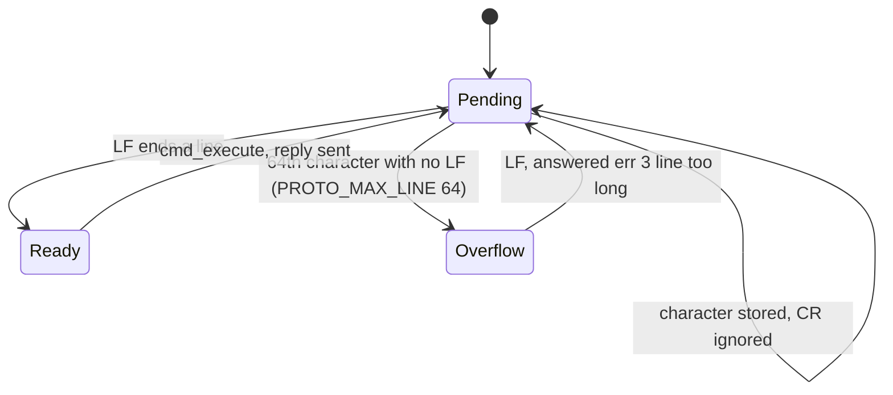

**Frequency generator, one per channel** (`fgen_state_t` in `fgen.h`):

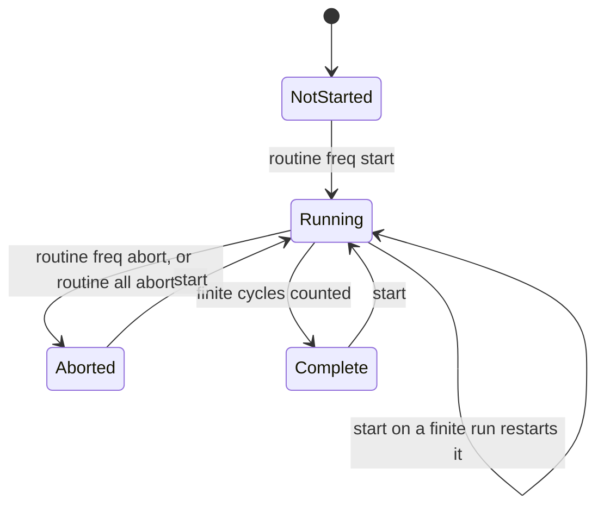

A start is refused while the channel is running with no cycle count. `wr`
stores a setting that takes effect at the next start.

| Behaviour | What moves it | Timing that matters |
|---|---|---|
| Main loop | `getchar_timeout_us`, then `fgen_poll`, then line assembly | `MAIN_POLL_US` 1000 µs. One core, no RTOS. |
| SHT30 reading | `sht30_measure`: command 0x2400, wait, read 6 bytes, CRC each word | `SHT30_MEASURE_WAIT_MS` 16 ms (datasheet maximum 15 + 1). I2C at 100 kHz, `BOARD_I2C_TIMEOUT_US` 10 ms per transfer. A failure answers `ACK rd temperature = Error`. |
| DAC output | DMA completion interrupt refills a buffer by `fgen_render` | 48 828.125 samples/s; 256 frames per buffer (about 2.6 ms); two buffers. |
| DAC mute | `fgen_poll` mutes after the last DAC channel stops | `FGEN_MUTE_HOLD_US` 50 ms; unmute settle `FGEN_UNMUTE_SETTLE_MS` 50 ms. On the bench no mute pin is wired, so no pin is driven. |
| Reboot / BOOTSEL | `cmd_finish` sends the reply, then reboots | `HAL_REBOOT_DRAIN_MS` 50 ms flush first. LEDs are off after a reboot. |
| Host reading | `read()` sends one `rd temperature` | `connect` timeout 2.0 s. Connect makes 4 round trips (`rd name`, `copyright`, `version`, `sha`). |
| Host flash (`flash.py`) | check UF2, enter bootloader (already there, `bootsel`, or 1200-baud touch), copy, wait for the drive to go, verify | Bootloader and reboot waits 15.0 s each; port wait 20.0 s; poll 0.25 s. |

### 8.6 SER-ARC-001, serial capture

Source: `instruments/serial_capture/capture.py`, `constants.py`.

`_Run.status` holds the state of the current run. `SerialCapture._run` is
guarded by a `threading.Lock`. With no run, `results()` reports Not Started.

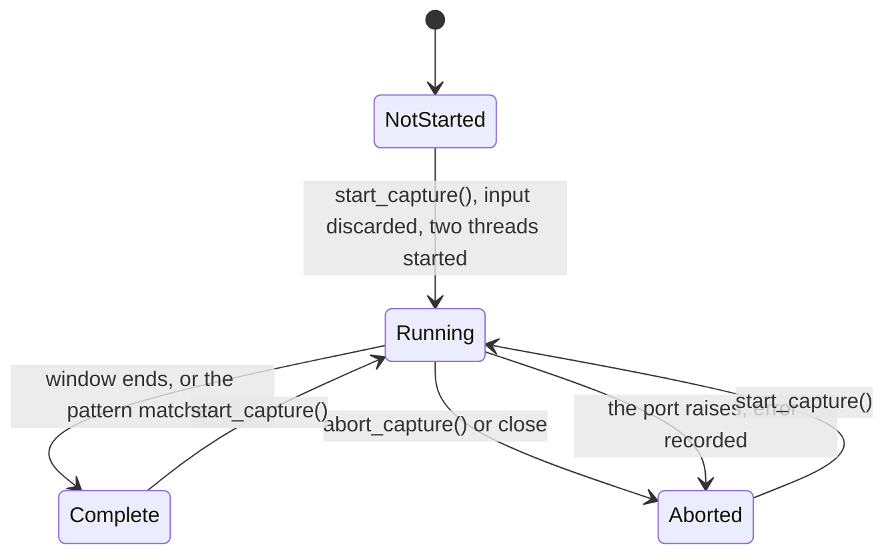

| Behaviour | What moves it | Timing that matters |
|---|---|---|
| Reading | thread `serial-capture` reads the port; thread `serial-capture-lines` shows lines | Read timeout `READ_POLL` 0.05 s; window default 5000 ms, 1 ms to 3 600 000 ms. |
| Start refused | a run in progress, or a thread from the last run still alive | `CaptureBusyError` |
| Line rate or format change | `_reconfigure` closes the port and reopens it with the new settings; on failure the old settings are restored | Refused while a capture runs. |
| Waiting | `wait_capture` | Remaining window + connect timeout (default 2.0 s). Threads joined with `_JOIN_TIMEOUT` 5.0 s. |

### 8.7 PSCOPE-ARC-001, PicoScope 3000D

Source: `instruments/picoscope3000/sdk.py`, `scope.py`.

`Ps3000aSdk._handle` holds the state: the unit is open while the handle is
above 0. The driver keeps its channel, port, timebase and sample settings and
sends them all at `_post_open`, leaving the trigger off.

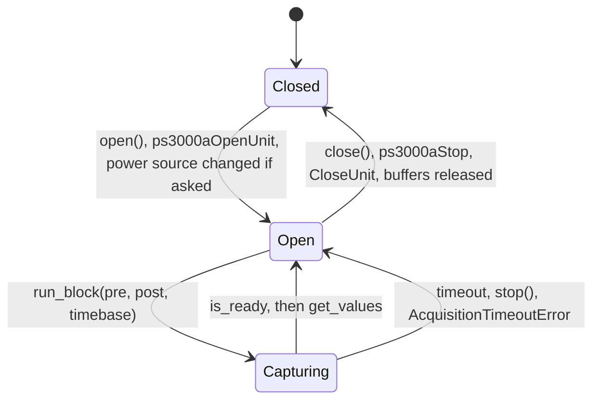

| Phase | What moves it | Timing that matters |
|---|---|---|
| Capture | `capture()`: `GetTimebase2`, `RunBlock`, poll, `GetValues` | Poll `is_ready()` every 5 ms; `timeout` 10.0 s by default (ETB-IF-002). |
| Buffers | `get_values` sets one `c_int16` buffer per enabled channel and port, kept in `_buffers` until read | Copied into Python lists afterwards. |

### 8.8 PPK-ARC-001, Power Profiler Kit II

Source: `instruments/ppk2/ppk2.py`, `constants.py`.

`Ppk2._mode` (None until known), `_vdd_mv` and `_powered` (None until the
driver switches it, because the kit cannot be asked) hold the state.
`voltage_limit` caps every setpoint.

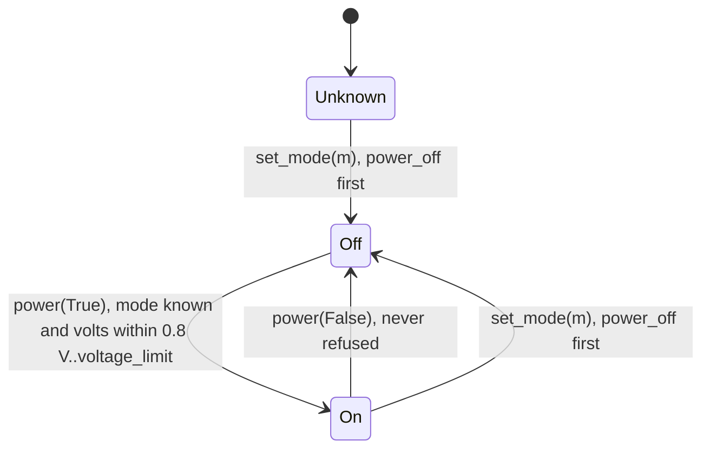

| Phase | What moves it | Timing that matters |
|---|---|---|
| Open | find the port by serial number, then open it, retrying while the kit re-enumerates | Retry every 0.1 s for up to `REENUMERATE_WAIT` 3.0 s. The kit is off USB for about 0.7 s each time its port closes (PPK2_Notes). |
| Metadata | `_post_open`: `AVERAGE_STOP`, settle, discard, then read the metadata to `END` | `STOP_SETTLE` 0.05 s; `METADATA_TIMEOUT` 3.0 s. The kit answers only the first request after the port opens. |
| Measurement | `_record`: discard, `AVERAGE_START`, read until the byte count, then `AVERAGE_STOP` in `finally` | 100 000 samples/s x 4 bytes. Read timeout `_STREAM_READ` 0.5 s; deadline = duration + transport timeout. Duration at most `MAX_DURATION` 120 s. Decoding happens after sampling stops (AD-31). |

### 8.9 JLINK-ARC-001, debug probe

Source: `instruments/jlink/probe.py`, `server.py`, `session.py`, `rtt.py`, `segger.py`, `commander.py`.

**GDB backend, `JLinkProbe`.** `_attached` and `_halted` hold the state.
`GdbMiSession` does not track run state from `*running` records. `_halted`
changes only through the probe's own methods. A `*stopped` record changes it
only in `wait_for_halt`.

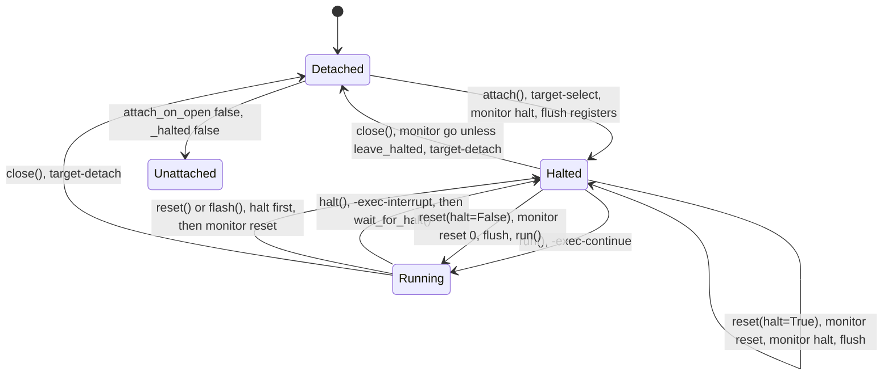

**GDB Server lifetime, `GdbServer`.** `_spawned` records whether this driver
started the server. Only a spawned server is stopped (JLINK-FR-005).

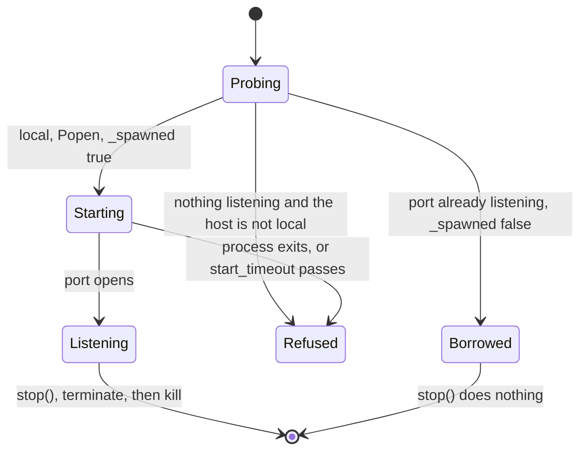

| Behaviour | What moves it | Timing that matters |
|---|---|---|
| Server start | `GdbServer.start()` | Port polled every 0.1 s, up to `start_timeout` 15.0 s; each poll has a 0.5 s socket timeout. Stop: `terminate`, wait 5.0 s, `kill`, wait 5.0 s. |
| MI command | `GdbMiSession.execute()` drains async records, sends, reads to the result with its token | Default 20.0 s. Attach 30.0 s; flash and restore 180.0 s; erase 120.0 s; halt and step 10.0 s; `wait_for_halt` 30.0 s. |
| Memory | `read_memory`, `write_memory` | Chunked at `max_transfer_bytes` 0x10000 (64 kB). |
| RTT | `RttClient.start()` and `stop()`; `_running` holds the state | A background thread polls every `_POLL_INTERVAL` 0.01 s. Join on stop 1.0 s. History is bounded at 10 000 lines. |
| SWO | `SwoStream` open, poll, close; no thread | Polled every 5 ms; `collect` default 10.0 s. |
| SEGGER backend (AD-30) | One J-Link Commander run per operation; `_halted` is read from DHCSR (0xE000EDF0, bit 17) after `r`, `g` and `h` | Commander run at least 60 s. RTT Logger start wait 10.0 s, polled every 0.1 s; quit wait 2.0 s. |

**Design rule J1: GDB's view of the target is kept true after `monitor` commands.**
J-Link GDB Server acts on a `monitor` command, but GDB does not see it. After
one, GDB keeps the registers and the run state it had before. The driver
therefore never trusts GDB's view after a `monitor` command that changes the
core:

1. **Flush the register cache after anything that resets or halts the core
   behind GDB's back.** Use `maintenance flush register-cache`. Do this after
   every reset and after an attach (`_flush_register_cache`). If GDB refuses,
   the driver raises. #178: after a reset, the PC read back the value from
   before the reset until the cache was flushed.
2. **Resume with `-exec-continue`, never `monitor go`, while the session goes on.**
   GDB then knows the core is running. `reset(halt=False)` resumes with `run()`.
   #177: the GDB Server halts the core after `monitor reset`, whatever the
   reset type.
3. **Halt with `-exec-interrupt` before any `monitor` command if the core runs.**
   GDB refuses every `monitor` command while the target runs.
   `_stop_if_running` does this before `reset` and `flash` (#259).
4. **Do not assume the core's state on attach.** A previous client's
   `monitor go` was never seen by GDB, so `attach()` sends `monitor halt` and
   flushes the register cache before it records `_halted` (#349).

The rule does not yet cover every case. `close()` still resumes with
`monitor go`, and rule 4 covers that at the next attach. No flush follows
`monitor("flash erase")` or a caller's own `monitor()`. `_halted` is not
updated from `*running` records.

### 8.10 BLE-ARC-001, BLE dongle (host and firmware)

Source: `instruments/nordic_dongle/dongle.py`, `session.py`; `firmware/nordic_dongle/src/nus_client.c`, `ble_scanner.c`, `cdc_acm.c`, `timestamp.c`.

**Host.** There is no reader thread: `DongleSession` reads lines when a call
asks for them. `NordicDongle._connected` holds the link to the sensor. During
`_open_link_once`, "linked" is a local variable only.

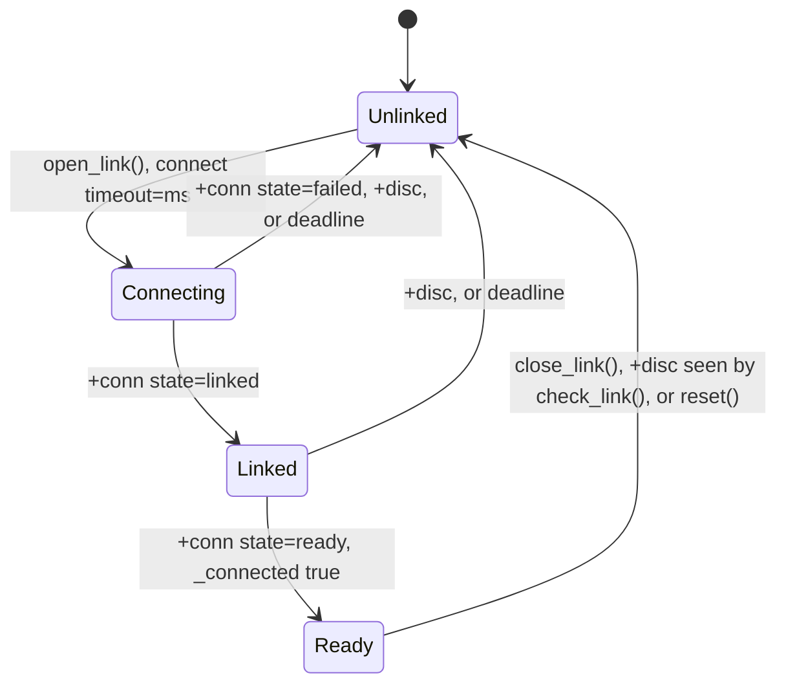

`open_link` retries an attempt that ended with reason 0x3e (not established),
up to `CONNECT_ATTEMPTS` = 3 times. If a `connect` is refused with error 4, 7
or 10, the host disconnects and tries again, then resets the dongle and tries
once more.

**Firmware, `nus_client.c`.** There is no enum. The state is in flags:
`m_conn_handle`, `m_connecting`, `m_ready`, `m_drop_on_connect`.

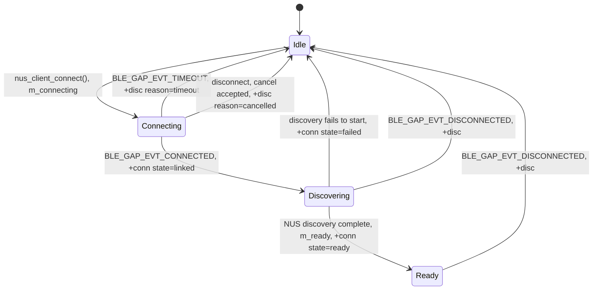

**Firmware scanner.** `m_scanning` holds the state, and each change sends
`+scan state=started|stopped`. A `connect` stops the scan first.

| Behaviour | What moves it | Timing that matters |
|---|---|---|
| Host reply wait | `execute()` drains, sends, reads until a reply; events met on the way are queued | `DongleSession` timeout 5.0 s. Event backlog `_EVENT_BACKLOG` 4096; the oldest event goes first. |
| Connect | `open_link` | `DEFAULT_CONNECT_TIMEOUT` 15.0 s + `SERVICE_DISCOVERY_TIMEOUT` 10.0 s per attempt. The firmware has no discovery timeout of its own. Firmware connect window 1000-60 000 ms, default 15 000. |
| Link parameters | firmware connect | Interval 7.5-30 ms (6-24 units), supervision 4 s, latency 0. |
| Command to the sensor | `cmd <hex> timeout=<ms>`; the firmware waits by polling and keeps servicing USB | Firmware 100-60 000 ms, default 2000 ms. Host waits that timeout + 1.0 s. No reply gives `err 8`. |
| Disconnect | `disconnect`, then wait for `+disc` | `DISCONNECT_EVENT_TIMEOUT` 6.0 s; a supervision-timeout `+disc` was measured at 3.9 s (BLE_Dongle_Notes). |
| Scan | `scan start <ms>`, then collect until `+scan state=stopped`, then `scan stop` | `DEFAULT_SCAN_MS` 3000; host collects for duration + 1.0 s. Firmware scan interval = window = 100 ms (continuous). |
| Dongle reset | `reset`, close, settle, reopen | `DONGLE_RESET_SETTLE` 2.5 s. |
| Firmware refresh | `ensure_firmware`: compare with the manifest, then `dfu`, `nrfutil`, reopen, check again | `settle` 3.0 s before and after; `nrfutil` 180.0 s. The firmware flushes its reply for up to 250 ms before entering the bootloader. |
| Firmware USB out | `cdc_acm_send` queues a line; `tx_pump` sends one at a time while the port is open | 32 slots; one always stays empty, so 31 lines wait at most. A line refused is dropped and counted in `m_dropped`. |
| Firmware clock | TIMER3 at 1 MHz, 32 bits, overflow counted in an interrupt to give 64 bits | Wraps every 71.6 min before extension. The timestamp is taken first in `scanner_on_ble_evt`. |

### 8.11 S2LP-ARC-001, S2-LP kit (ST firmware and kit firmware)

Source: `instruments/s2lp/s2lp.py`, `kit_driver.py`, `kit_firmware.py`, `session.py`, `traffic.py`; `firmware/s2lp_kit/src/rx.c`, `ring.c`, `main.c`, `hal_l053.c`.

**Which firmware the board runs.** `S2lpDevkit._session` holds the session. It
starts as an `S2lpSession`. `_choose_session` replaces it with a `KitSession`
if the board answers the `id` probe as the kit firmware (AD-32).

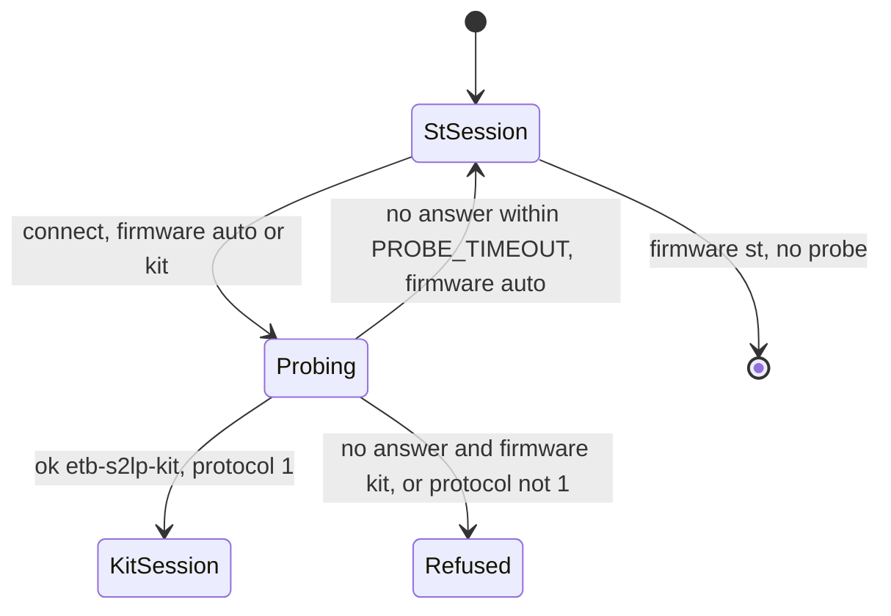

**ST firmware, polled receive** (`_stream_polled`). There is no state variable;
each phase runs inside the call.

| Phase | What moves it | Timing that matters |
|---|---|---|
| Prepare | first receive: GPIO3 as nIRQ, IRQ mask, RX timeout 0 | One command round trip each. |
| Armed | `S2LPGetNBytes 0xFFFF`, then wait for the reply | Waits for the stream's remaining time. On timeout the host sends `S`, waits up to 2.0 s for `StopCmd`, and keeps any reply that came with it. |
| Packet and registers | reply parsed; one `SdkEvalSpiReadRegisters` for the asked registers | 14-17 ms for the register read (S2LP_Devkit_Notes). |
| Re-arm | next `S2LPGetNBytes` | The radio is deaf from the frame to the re-arm: 26-27 ms measured (#293). On the bench, gaps under about 105 ms were missed by the polled stream (`traffic.py` docstring); the shortest received was 108 ms (Notes). |

**Kit firmware, interrupt receive.** `m_running` in `rx.c` holds the state.
The UART interrupt has priority over the radio's (0x00 against 0x40), because
a USART byte overruns 174 µs after it arrives.

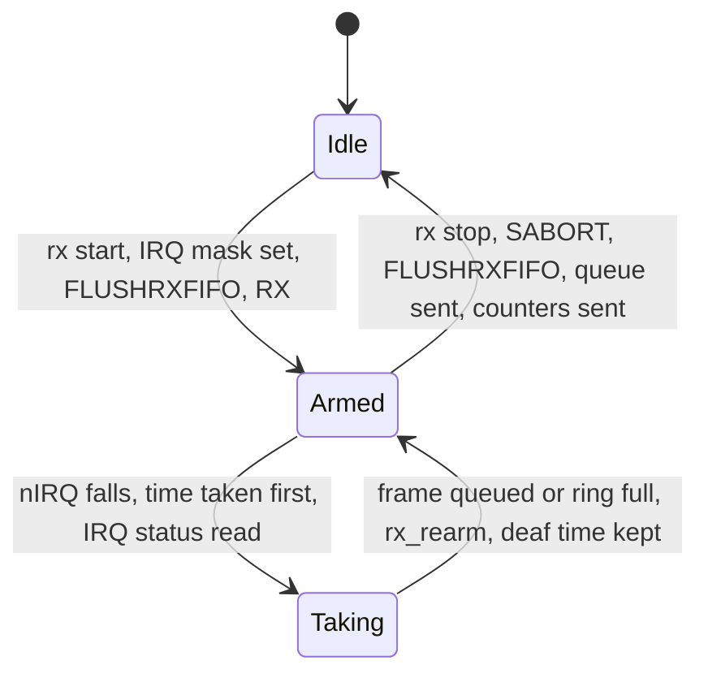

While the radio is receiving, `rd`, `wr`, `cmd` and `sdn` answer
`err receiving`. `id`, `stat` and `rx` are still taken.

| Behaviour | What moves it | Timing that matters |
|---|---|---|
| Interrupt | `hal_exti0_1_isr` calls `rx_on_irq` while PC0 stays low | Up to 4 passes. A frame's interrupt takes up to 393 µs (`hal_l053.c`). Deaf time is measured per frame and the longest is reported as `deaf_max_us`. |
| Queue | `ring_claim`, `ring_commit`; the main loop sends one record a pass | `RING_SIZE` 16 records. When it is full, the frame is counted in `overflows` and its sequence number used, so the host sees the gap (`lost_before`). |
| Board time | TIM2 at 1 MHz with a software upper half | 1 µs resolution, 32-bit µs value. |
| Host `KitSession` | `receiving` true from the `rx start` answer to the `rx stop` answer | `PROBE_TIMEOUT` 1.0 s; `STOP_TIMEOUT` 5.0 s; line poll 0.05 s. |

### 8.12 VIEW-ARC-001, viewer, and the run control channel

Source: `viewer/server.py`, `state.py`; `runner/control.py`.

**Run as the viewer rebuilds it** (`RunState.status` and `paused`). The final
status is whatever the runner wrote in `run_end`.

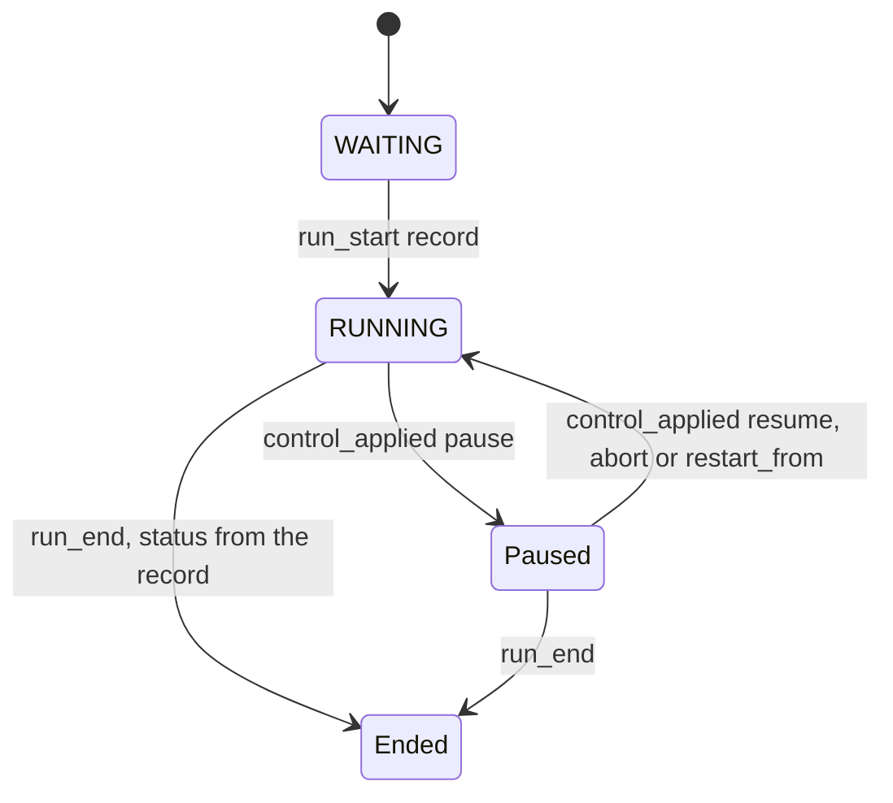

**Run control channel** (`runner/control.py`). It reports `idle`, `running` or
`paused`. The runner reaches a `checkpoint` only between steps, so a command
takes effect at the next step boundary. In teardown, `checkpoint` neither
blocks nor returns a command.

| Behaviour | What moves it | Timing that matters |
|---|---|---|
| Following the log | thread `viewer-tail`: `EventTail.read()`, then wait | Every 0.2 s (`Hub(interval=0.2)`). |
| Server-Sent Events | one request thread per client waits on the hub's condition | Keep-alive every `KEEPALIVE_S` 15.0 s. No queue per client. |
| Start a run | `Launcher.start()` runs `python -m benchtools run ... --control 0` as a separate process | One run at a time. |
| Control request | viewer `send_control` to 127.0.0.1 | 5.0 s; no answer gives 502, no port gives 409. Request line at most 4096 bytes. |
| Exposure | a non-loopback bind needs a token; `--read-only` refuses every POST | Token from `secrets.token_urlsafe(32)`. |

### 8.13 Not established

- The ST CLI firmware's own internal states: it is ST's, outside this project (AD-20).
- Whether a core halted by one J-Link Commander run stays halted after the run exits (AD-30 says this is not known).
- A rate limit for the BLE dongle's USB link: the notes give latency (up to 1 ms polling) but no throughput figure.

---

## 9. Resource and performance characteristics

| Aspect | Value |
|---|---|
| Memory per captured channel | ~10 000 points as three Python lists, roughly 1 MB per channel. |
| Round trips per channel captured | 3 (`DATA:SOURCE`, batched preamble, `CURVe?`); the preamble is one compound query rather than seven. |
| Round trips per channel configured | 2 (one compound setup message, one error check). The error check is disableable. |
| Wire volume per 10 000-point record | ~10 kB binary versus ~50 kB ASCII. Binary is the default. |
| Instrument connections per run | One per alias actually used; connection is lazy. |
| Processes per probe connection | Two at most: the GDB Server (only if not already listening) and one GDB. |
| Round trips per probe halt/read/resume | 3 MI commands; a variable read is 1. Memory is chunked at the probe's maximum transfer size (64 kB). |
| Advertising reports per second, one sensor | 3 channels at the advertising rate; at 20 ms that is up to 150 lines/s, about 20 kB/s over USB. |
| Dongle event queue | 32 slots, of which at most 31 lines wait: the full check keeps one slot empty (`cdc_acm.c`). Above that, lines are dropped and counted (`m_dropped`, read through `ver` and `adv stats`) rather than truncated. |
| Host event backlog | 4096 events, bounded so an unattended session cannot grow without limit. |
| Cost of a halting timing measurement | Two breakpoint stops per repetition; the target is stopped for the duration, which is why JLINK-FR-064 exists. |
| PSU: link | 9600 baud by default (`DEFAULT_BAUDRATE`; 57 600 and 115 200 also supported). Commands end in LF; replies end in CR (`REPLY_TERMINATOR`). |
| PSU: command pacing | At least 50 ms between commands on a real link (`DEFAULT_COMMAND_INTERVAL` 0.05, `psu.py _pace`), and none on a simulated link. No minimum gap was found on the bench, from 0 to 200 ms (ETB-IF-001, PSU-OPEN-03). |
| PSU: reply latency | 17-30 ms for `VSET?`, `ISET?`, `VOUT?` and `IOUT?`; 58 ms for `*IDN?`. `STATUS?` sends 137 bytes and takes about 143 ms to the last byte at 9600 baud (ETB-IF-001). |
| PSU: round trips per operation | Setpoint on channel 1: 1 write. Setpoint on channel 2: 1 `STATUS?` (AD-21), then 1 write. Read-back: 1 query, or none for a parked channel. `read_channel`: up to 5 queries (`psu.py`). |
| PSU: timeouts | `connect(timeout=5.0)`, applied to each reply. Safe state settles for 0.2 s (`reset(settle=0.2)`). |
| PSU: memory and threads | One float per parked channel (`_parked`). No threads. |
| DMM: link and rate | 9600 baud 8N1, DTR on, RTS off (`constants.py`). One 10-byte frame per reading (`FRAME_LENGTH`), every 0.4 s (`READING_INTERVAL`), about 25 B/s (derived). |
| DMM: timeouts | Read poll fixed at 0.05 s (`READ_POLL`). Key echo 0.3 s, three sends at most (`ECHO_TIMEOUT`). Confirmation at least 4.0 s (`CONFIRM_TIMEOUT`); settling 2.0 s; ranging 6.0 s; frequency gate 1 s or 10 s (`GATE_TIME`). |
| DMM: time per operation | Measurement 0.4-0.8 s (one frame discarded, the next returned); frequency on the 4 kHz range up to 20 s (AD-26). A function change takes 1-2 s (AD-25). |
| DMM: memory and threads | A frame buffer, a residue for echoes, and the decoded readings not yet used (`FrameAssembler`, `_ready`). No threads (AD-26). |
| S2LP: link | 115 200 baud 8N1 on both firmwares (`constants.DEFAULT_BAUDRATE`; kit firmware `HAL_USART_BRR_115200`). Kit firmware lines end in CR LF. |
| S2LP: ST firmware timing | Reply timeout 5.0 s (`DEFAULT_TIMEOUT`); line poll 0.05 s (`session.READ_POLL`); stop acknowledgement wait 2.0 s. Deaf time between polled receptions 26-27 ms (#293); register read 14-17 ms (S2LP_Devkit_Notes). |
| S2LP: kit firmware timing | Board time 1 µs resolution (TIM2 at 1 MHz). A frame's interrupt takes up to 393 µs (`hal_l053.c`); the longest deaf time is reported as `deaf_max_us`. Host probe 1.0 s (`PROBE_TIMEOUT`); stop 5.0 s (`STOP_TIMEOUT`). |
| S2LP: buffers | Host: payload at most 255 bytes on ST's CLI (`MAX_PAYLOAD`); radio FIFO 128 (`FIFO_SIZE`); 200 unclaimed lines kept (`UNCLAIMED_LIMIT`). Kit firmware: 16 records (`RING_SIZE`), each up to 128 payload bytes (`PROTO_MAX_PAYLOAD`) and 8 registers; command line 300 characters (`PROTO_LINE_MAX`); UART input 128 bytes (`HAL_RX_SIZE`). The ring is about 2.4 KB (derived) of the board's 8 KB RAM (`stm32l053r8.ld`). |
| S2LP: overflow | Kit firmware: a frame that finds the ring full is counted in `overflows` and its sequence number is used, so the host reports the gap (`lost_before`). |
| S2LP: threads | None on the host. The firmware has a main loop and interrupts, with UART at priority 0x00 and radio and timer at 0x40. |
| PICO: link | USB CDC; the line rate is ignored (`DEFAULT_BAUDRATE` 115 200 is nominal). Replies end in LF. |
| PICO: round trips | 1 per temperature reading (`rd temperature`); 4 at connect (`rd name`, `copyright`, `version`, `sha`). `start_freq`: 3 or more `wr` and 1 `routine`. |
| PICO: time per reading | At least 16 ms on the board (`SHT30_MEASURE_WAIT_MS`) plus the I2C transfers at 100 kHz. Each I2C transfer times out at 10 ms (`BOARD_I2C_TIMEOUT_US`). |
| PICO: host timeouts | `connect` 2.0 s. Flash: bootloader wait 15.0 s, reboot wait 15.0 s, port wait 20.0 s, polled every 0.25 s (`flash.py`). |
| PICO: firmware buffers | Command line 64 bytes with its terminator (`PROTO_MAX_LINE`); reply 192 (`PROTO_MAX_REPLY`); 4 tokens. Frequency generator table 4096 entries (`FGEN_TABLE_SIZE`); DAC DMA two buffers of 256 frames (512 32-bit words) each (`HAL_DAC_*`), about 2.6 ms of output per buffer. |
| PICO: firmware rates | DAC 48 828.125 samples/s (`FGEN_SAMPLE_RATE_MHZ`, 150 MHz system clock, PIO divider 24). Main loop poll 1 ms (`MAIN_POLL_US`). |
| PICO: threads | None on the host. Firmware: one core and no RTOS; the DMA and PWM interrupts run the generator. |
| PSCOPE: capture | One block per capture: `RunBlock`, then poll `is_ready()` every 5 ms, then `GetValues`. Timeout 10.0 s by default (`scope.timeout`, ETB-IF-002). |
| PSCOPE: default record | 10 000 samples, 20 % before the trigger (`_samples`, `_pre_trigger`). |
| PSCOPE: memory | Host: one `c_int16` buffer per enabled channel and port, 2 bytes per sample, then copied into Python lists. Unit: at most 268 435 200 samples with channel A alone; 67 108 800 with four channels (`ModelLimits.max_samples`; PicoScope3000_Notes). The driver does not check a length against this; the library refuses one too long. |
| PSCOPE: rate and threads | At most 1 GS/s (`max_sample_rate_hz`). No threads. |
| PPK: stream | 100 000 samples/s (`SAMPLE_RATE`) x 4 bytes (`SAMPLE_BYTES`) = 400 kB/s (derived; AD-31). |
| PPK: memory | Raw bytes are kept during sampling (4 B per sample) and decoded afterwards into amps (8 B) and logic (1 B) per sample: 9 B per sample, about 108 MB for the longest measurement (`constants.py`). |
| PPK: limits and timeouts | Measurement at most 120 s (`MAX_DURATION`). Metadata 3.0 s (`METADATA_TIMEOUT`); stream read 0.5 s (`_STREAM_READ`); stop settle 0.05 s; re-enumeration wait 3.0 s (`REENUMERATE_WAIT`). The kit is off USB for about 0.7 s when its port closes (PPK2_Notes). |
| PPK: time per measurement | A 5 s capture took 6.0 s in all on the bench (PPK2_Notes). |
| PPK: threads | None. Reading and decoding run on the caller's thread. |
| VIEW: log following | Event log re-read every 0.2 s by one thread (`Hub(interval=0.2)`). |
| VIEW: clients | One thread per HTTP request (`ThreadingHTTPServer`), no queue per client; keep-alive every 15.0 s (`KEEPALIVE_S`). Default port 8130. |
| VIEW: memory bounds | 5000 records (`KEEP_RECORDS`); 5000 per step and 50 000 per run (`KEEP_STEP_RECORDS`, `KEEP_RUN_RECORDS`); 2000 exchanges per source (`KEEP_EXCHANGES`); 5000 points per series (`KEEP_POINTS`); 1000 frames and 1000 BLE events (`KEEP_FRAMES`, `KEEP_BLE_EVENTS`). POST body at most 64 kB. |
| VIEW: control channel | The runner listens on 127.0.0.1 only, JSON Lines, request at most 4096 bytes (`_MAX_LINE`). The viewer waits 5.0 s for an answer. A command takes effect at the next step boundary. |
| VIEW: processes | One run at a time, started as a separate process (`Launcher`). |

---

## 10. Interfaces to external elements

| Interface | Direction | Description |
|---|---|---|
| Ethernet / VXI-11 | bidirectional | ONC-RPC to instruments. |
| File system | in | Test specifications and bench configurations (JSON or YAML). |
| File system | out | CSV records, plots, hardcopy images, JSON/markdown/JUnit reports. |
| Process exit status | out | 0 pass, 1 failure or error, 2 usage — so the runner is usable directly as a CI step. |
| `pyyaml` | in | Optional; YAML specifications. JSON needs nothing. |
| `matplotlib` | out | Optional; host-side plots. |
| `pyvisa` | bidirectional | Optional; alternative transport. |
| J-Link GDB Server | bidirectional | TCP: GDB/MI via GDB on port 2331, RTT on 19021, SWO on 2332. May be on another host. |
| `arm-none-eabi-gdb` | bidirectional | Child process over stdin/stdout, speaking GDB/MI. Required for the J-Link driver only. |
| SWD / JTAG | bidirectional | Probe to target, below the GDB Server; not visible to this software. |
| USB CDC (serial) | bidirectional | The BLE dongle's line protocol. May be a local port or one published over TCP by a terminal server, which is how a container reaches a dongle on another machine. |
| Bluetooth Low Energy | bidirectional | Dongle to sensor: advertising reports in, UART service both ways. Below the dongle firmware; not visible to the host driver except as events. |
| `pyserial` | bidirectional | Optional; the serial transport. |
| nRF5 SDK 17.1.0 + S140 | in | Builds the dongle firmware. Not needed to run the host driver or the tests. |
| USB serial — GW Instek GPD-3303D | bidirectional | The supply's own command set, not SCPI: LF out, CR back, 9600 8N1 (ETB-IF-001). |
| RS-232 through a USB serial adapter — Aim-TTi 1604 | bidirectional | The meter's display-frame stream in; single key codes out. DTR on and RTS off power its optical link; read as a stream, not by query (AD-25, AD-26). |
| USB serial — ST S2-LP kit | bidirectional | ST's CLI firmware command set (AD-20), or the project's kit firmware's line protocol (AD-32, `firmware/s2lp_kit/include/protocol.h`), chosen by the kit's `id` reply. |
| J-Link Commander | bidirectional | The second J-Link backend (AD-30): SEGGER's `JLink.exe`, driven as a child process (`instruments/jlink/commander.py`, `segger.py`), chosen by the bench configuration. |
| USB CDC (serial) — thermometer | bidirectional | The Pico 2 thermometer's line protocol (`firmware/pico2_test_board/include/protocol.h`). |
| USB CDC — Nordic Power Profiler Kit II | bidirectional | The PPK2's serial protocol (AD-31): one-byte opcodes with their arguments out; its metadata text and a stream of 32-bit samples, 100 000 a second, in. Found by its USB identity (0x1915:0xC00A) and serial number. Specified, command by command, in `docs/ppk2/PPK2_Notes.md`. |
| Power and logic — PPK2 to the device under test | bidirectional | In source mode the PPK2's VOUT supplies the device at 0.8 V to 5.0 V; in ammeter mode an outside supply on VIN reaches the device through the kit. Eight logic inputs, D0 to D7, are sampled with the current. Nothing is wired to them on the bench PC as of 2026-11-14. |
| Serial port — device under test | in | A device's console or test UART, read by the serial capture instrument through a USB serial adapter. Receive only: the instrument writes nothing to it. |
| USB — PicoScope 3000D MSO | bidirectional | The PicoScope 3405D MSO on USB, through Pico Technology's WinUSB driver (version 2.4.0.2, dated 2022-06-10, on the bench PC). Not visible to this software: every exchange with the unit goes through the `ps3000a` library. Its inputs are four analogue channels and sixteen digital inputs; its only output is the signal generator. |
| `ps3000a` C library (Pico Technology) | bidirectional | Optional; called through `ctypes` by the PicoScope driver, with no Pico Python package. Installed with PicoScope 7 or the PicoSDK, and found from the bench's `sdk_path`, `PICOSDK_PATH`, the install folders or the system's library path. Not needed to import the driver or to run the tests. On the bench PC it is the `ps3000a.dll` of PicoScope 7 T&M Stable, reporting driver version 2.2.160.7569 (ETB-ACQ4-001 §4.4). Specified, call by call, with every dependency, in ETB-IF-002. |
| I2C | bidirectional | Pico 2 to SHT30-DIS, 100 kHz, address 0x44. Below the thermometer firmware; not visible to the host driver except as `err 4`/`err 6`. |
| GPIO — thermometer LEDs | out | Pico 2 GP18, GP19 and GP20 to the red, yellow and green indicator LEDs, each lit by driving its pin high (#328). Set by `wr` and read back by `rd` from the pins' output latches. |
| I2S and GPIO — frequency generator | out | Pico 2 GP6 (DIN), GP7 (BCLK) and GP8 (WSEL) to an Adafruit UDA1334A board (NXP UDA1334A DAC), generator channels 1 and 2; its `MUTE` input is not connected on the bench. GP15 carries channel 3, a square wave (#202). |
| Raspberry Pi Pico C SDK 2.1.1 + Arm GNU toolchain | in | Builds the thermometer firmware into a UF2 image. Not needed to run the host driver or the tests. |

---

## 11. Review & Approval

Review and approval of this document are not entered in this table. They are
given by the merge of the pull request that last changed the document, and that
merge is the record (ETB-SUP8-001 §5.7). The evidence is the pull request, its
CI result and its merge record: who merged it, when, and the merge commit. The
last row of the revision history names the issue, and the issue links the pull
request.

| Role | Name | Recorded by |
|---|---|---|
| Author | Claude | The commits in the pull request |
| Technical Reviewer | Dermot Murphy | The merge of the pull request that last changed this document |
| Quality Assurance | Dermot Murphy | The merge of the pull request that last changed this document |
| Approver | Dermot Murphy | The merge of the pull request that last changed this document |

> **Note:** This document is under configuration management (SUP.8). Post-approval changes require a change request (SUP.10) and a new document version.
