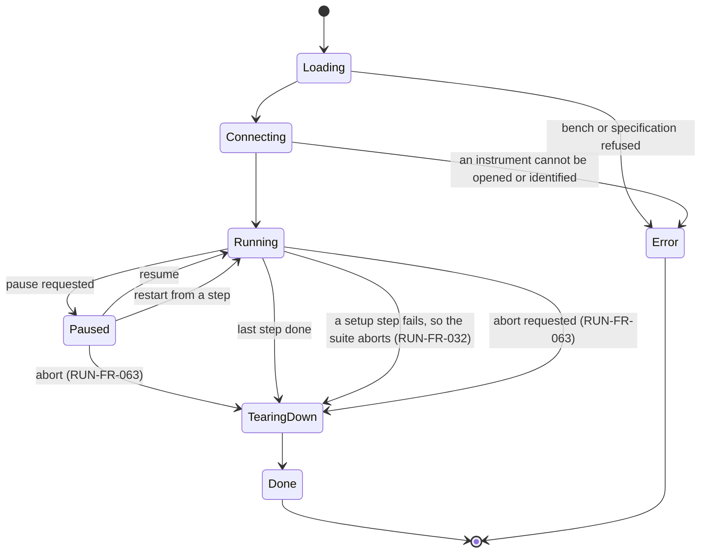

# System Architecture

*Automotive SPICE® PAM v4.0 | SYS.3 — System Architectural Design*

---

## 1. Document Identification & Control

| Field | Value | Field | Value |
|---|---|---|---|
| **Document ID** | ETB-SYS3-001 | **Version** | [latest, §2](#2-revision-history) |
| **Project** | Embedded Test Bench | **Date** | [latest, §2](#2-revision-history) |
| **Status** | [by location, ETB-SUP1-001 §6.3](EmbeddedTestBench_SUP1_Quality_Assurance_Plan.md#63-document-status) | **Classification** | Internal |
| **Author** | Claude | **Reviewer** | Dermot Murphy |
| **Approver** | Dermot Murphy | **Related Process** | SYS.3 |

> Reviewer and Approver are the same person; see ETB-DEV-002.

---

## 2. Revision History

| Version | Date | Author | Description of Change |
|---|---|---|---|
| 0.1 | 2026-09-19 | Claude | Initial |
| 0.2 | 2026-09-26 | Claude | TB-SIF-02 refers to its interface specification, TB-IF-001 (#63). |
| 0.3 | 2026-10-04 | Claude | #183: product renamed to Embedded Test Bench - document file name prefix `EmbeddedTestBench_`, identifier prefix `ETB-` (was `TB-`), product name in prose. Earlier revision rows keep the names in use when they were written. |
| 0.4 | 2026-10-05 | Claude | #204: Review & Approval table points to the merge of the pull request that last changed the document, which is the review and approval (ETB-SUP8-001 §5.7); no per-change signatures or dates. |
| 0.5 | 2026-10-05 | Claude | #194: the compact brand logo added above the title, the same line in every controlled document (ETB-SUP8-001 §6.3). |
| 0.6 | 2026-10-25 | Claude | #210: Version and Date in the identification table are links to the last revision history row, which holds them (ETB-SUP8-001 §6.2). |
| 0.7 | 2026-11-13 | Claude | #200: SE-PSCOPE, the PicoScope 3405D MSO; ETB-SIF-12 (host to scope, specified in ETB-IF-002) and ETB-SIF-13 (target to scope); §6.1 containerisation. |
| 0.8 | 2026-11-14 | Claude | #342: SE-PPK, the Nordic Power Profiler Kit II; ETB-SIF-14 (host to kit) and ETB-SIF-15 (kit to target); §6.1 containerisation. |
| next | 2026-11-17 | Claude | #371: the Status cell links to the status rule, ETB-SUP1-001 §6.3. A document's status follows from where it is in the repository (Released, Agreed, In review, In work) and is not written in by hand. |
| next | 2026-11-17 | Claude | #377: Referenced Documents cite each controlled document at the version of its last numbered revision row, kept by `scripts/doc_versions.py` (ETB-SUP8-001 §6.2). |
| next | 2026-11-17 | Claude | #365: §5.1 adds SE-DMM, SE-PICO2 and SE-SERIAL, and SE-S2LP's second firmware; §5.2 adds SE-VIEWER and SE-PLUGINS; §5.3 restated for the kit's own firmware. §6 adds ETB-SIF-16 to -19. §7 allocates ETB-SYS2-017 and -051 to -053. §8 splits into the run (§8.1), its operating modes as a state diagram (§8.2), error paths (§8.3) and timing (§8.4). §9 adds the PicoScope, PPK2, TTi 1604 and kit firmware. §10.0 adds evaluation criteria and the alternatives compared for each decision. SD-05 restated for #84. |
| next | 2026-11-17 | Claude | #365, review round 1 (PR #393): §8.2 - abort from Paused, and restart refused during setup; §8.3 - the paths for an operator abort, a setup failure and a refused control request. |
| next | 2026-11-17 | Claude | #364: §7 allocates ETB-SYS2-018, -026, -037, -054, -055, -065, -080 to -086, which had no element, and points to the per-requirement allocation in ETB-RTM-001. |

---

## 3. Purpose & Scope

### 3.1 Purpose

This document describes the Embedded Test Bench system as a set of physical and logical
elements and the interfaces between them, and allocates the system requirements
of ETB-SYS2-001 to those elements.

The software architecture — how `benchtools` is decomposed internally — is
ETB-SWE2-001. This document stops at the boundary of the host software and
describes what is on the other side of each wire.

### 3.2 Referenced Documents

| Document ID | Title | Version |
|---|---|---|
| ETB-SYS2-001 | Embedded Test Bench System Requirements Specification | 0.10 |
| ETB-SYS4-001 | Embedded Test Bench System Integration & Integration Test | 0.6 |
| ETB-SWE2-001 | Embedded Test Bench Software Architecture | 0.33 |
| ETB-SWE1-001 | Embedded Test Bench Software Requirements Specification | 1.70 |
| ETB-MAN5-001 | Embedded Test Bench Risk Management Plan | 0.7 |
| ETB-ACQ4-001 | Embedded Test Bench Supplier Monitoring Plan | 0.11 |

### 3.3 Scope

The bench host, the instruments, the transports between them, the firmware
Embedded Test Bench supplies, and the target under test as the bench sees it.

---

## 4. Architectural Drivers

| ID | Driver | Source | Consequence |
|---|---|---|---|
| ETB-SAD-01 | A result must be reproducible from what was recorded | ETB-SYS2-001 | Every element that can identify itself does so, and the identity is recorded per run |
| ETB-SAD-02 | The bench must run with no hardware attached | ETB-SYS2-012 | Every instrument element has a simulated counterpart behind the same interface |
| ETB-SAD-03 | The bench should containerise | ETB-SYS2-090 | Transports are network links where the instrument allows it; USB-bound elements are the ones that constrain this |
| ETB-SAD-04 | Timing must be attributable | ETB-SYS2-043, ETB-SYS2-077 | Measurement is done as close to the event as the hardware allows, and the method's resolution travels with the number |
| ETB-SAD-05 | A tool must not make a claim it cannot support | ETB-SYS2-003, ETB-SYS2-004, ETB-SYS2-016 | Failure and error are distinct; simulation is disclosed; unsatisfiable requests are refused |
| ETB-SAD-06 | No vendor source may be vendored | ETB-ACQ4-001 §4.2 | The S2-LP element is a host driver over a vendor firmware interface, not a firmware element |

---

## 5. System Elements

### 5.1 Physical Elements

| Element | What it is | Supplied by | Interface to the host |
|---|---|---|---|
| **SE-HOST** | The bench host — a PC or a container running `benchtools` | This project (software) | — |
| **SE-SCOPE** | Tektronix TDS3014B oscilloscope | Tektronix | Ethernet, VXI-11 |
| **SE-PSCOPE** | PicoScope 3405D MSO: four analogue channels, 16 digital inputs, signal generator (#200) | Pico Technology | USB, through Pico's `ps3000a` library |
| **SE-PSU** | GW Instek GPD-3303D bench supply | GW Instek | USB serial, 9600 8N1 |
| **SE-PPK** | Nordic Power Profiler Kit II: supply and current meter, 100 000 samples a second, eight logic inputs (#342) | Nordic Semiconductor | USB CDC, the kit's own binary protocol |
| **SE-PROBE** | SEGGER J-Link debug probe | SEGGER | USB, presented as TCP: GDB server and RTT |
| **SE-DONGLE** | Nordic nRF52840 dongle (PCA10059) | Hardware: Nordic. Firmware: **this project** | USB serial (CDC ACM) |
| **SE-S2LP** | ST S2-LP development kit | Hardware: STMicroelectronics. Firmware: ST's CLI firmware, or **this project's** kit firmware (#84) | USB serial |
| **SE-DMM** | Aim-TTi 1604 bench multimeter | Aim-TTi | RS-232 through a USB serial adapter; the meter sends display frames continuously |
| **SE-PICO2** | PICO2 Test Board: a Raspberry Pi Pico 2 with an SHT30 sensor, indicator LEDs and a UDA1334A audio DAC | Hardware: this project's assembly of bought parts. Firmware: **this project** | USB serial (CDC ACM) |
| **SE-SERIAL** | A USB serial adapter on the target's console or test UART | Any | USB serial; the bench only listens |
| **SE-TARGET** | The device under test | The project being tested | Debug port (to SE-PROBE), BLE (to SE-DONGLE), sub-GHz radio (to SE-S2LP), power (from SE-PSU, or from or through SE-PPK), signals (to SE-SCOPE and SE-PSCOPE), serial output (to SE-SERIAL) |

### 5.2 Logical Elements on the Host

| Element | Responsibility | Detailed in |
|---|---|---|
| **SE-CORE** | Transports, framing, validation, bench model, report writing, firmware manifests | ETB-SWE2-001 §5 |
| **SE-DRIVERS** | One driver per instrument, each with a simulator behind the same interface | ETB-SWE2-001 §6 |
| **SE-RUNNER** | Loads a specification and a bench, executes steps, evaluates expectations, writes reports | ETB-SWE2-001 §6 |
| **SE-ANALYSIS** | Measures quantities from captured records, on the host | ETB-SWE2-001 §6 |
| **SE-VIEWER** | Shows a run while it goes and lets an engineer control it, from the event log | ETB-SWE2-001 §6 |
| **SE-PLUGINS** | Device-specific decoders, register files and viewer panels, loaded from outside the core (#238) | ETB-SWE2-001 §6 |

### 5.3 The Dongle Is One Element in Two Halves

SE-DONGLE's firmware and its host driver are designed together and specified as
one element (`BLE-` in ETB-SWE1-001 §11). The protocol between them is a single
design decision; splitting it across two elements would let the halves drift
apart, and the timing requirement ETB-SYS2-043 — measure in the dongle, keep the
host's timestamps beside it — only makes sense if both halves are designed to
it at once.

The S2-LP element is different. With ST's CLI firmware, the command set is an
external interface that Embedded Test Bench observes rather than defines
(ETB-SYS2-047). With the project's own kit firmware (#84), the line protocol is
this project's, and the host and firmware halves are designed together as the
dongle's are. The driver identifies which firmware runs, with the kit's `id`
reply, before it uses either command set.

---

## 6. Interfaces

| ID | Between | Medium | Protocol | Notes |
|---|---|---|---|---|
| ETB-SIF-01 | SE-HOST ↔ SE-SCOPE | Ethernet | VXI-11 / SCPI | Implemented directly; no VISA runtime required (ETB-SWE2-001 AD-01) |
| ETB-SIF-02 | SE-HOST ↔ SE-PSU | USB serial | GW Instek command set | Not SCPI; LF out, CR back; status word spaced and followed by a legend. Specified in ETB-IF-001 |
| ETB-SIF-03 | SE-HOST ↔ SE-PROBE (control) | TCP | GDB/MI to the J-Link GDB server | Network link, so this element containerises |
| ETB-SIF-04 | SE-HOST ↔ SE-PROBE (RTT) | TCP | J-Link RTT telnet channel | As above |
| ETB-SIF-05 | SE-HOST ↔ SE-DONGLE | USB serial | Embedded Test Bench dongle protocol — this project's own | Carries dongle-side timestamps (ETB-SYS2-043) |
| ETB-SIF-06 | SE-HOST ↔ SE-S2LP | USB serial | ST's firmware command set | External interface; observed, not defined here |
| ETB-SIF-07 | SE-DONGLE ↔ SE-TARGET | BLE | GAP advertising; UART service for command/response | Target identifier appears in the advertising name (ETB-SYS2-045) |
| ETB-SIF-08 | SE-PROBE ↔ SE-TARGET | SWD | Debug access, RTT control block in target RAM | |
| ETB-SIF-09 | SE-PSU ↔ SE-TARGET | Wires | Power | Tracking mode constrains what may be set (ETB-SYS2-023) |
| ETB-SIF-10 | SE-TARGET ↔ SE-SCOPE | Probes | Analogue signals | Up to four channels |
| ETB-SIF-11 | SE-HOST ↔ CI | Files | JUnit XML, markdown reports | ETB-SYS2-079 |
| ETB-SIF-12 | SE-HOST ↔ SE-PSCOPE | USB | Pico Technology's `ps3000a` C library, called through `ctypes` | No command text on a wire: the interface is the set of library calls. Specified in ETB-IF-002 |
| ETB-SIF-13 | SE-TARGET ↔ SE-PSCOPE | Probes, logic leads, BNC | Analogue and logic signals in; the signal generator out | Up to four analogue channels and 16 digital inputs in one acquisition (ETB-SYS2-065). On the bench PC, channel A is wired to the PICO2 Test Board's generator channel 1 |
| ETB-SIF-14 | SE-HOST ↔ SE-PPK | USB CDC | The PPK2's binary protocol: opcodes out; metadata text and 32-bit samples in, 100 000 a second | Found by USB serial number. The kit answers its metadata once per open, and goes off USB for under a second when its port closes. Specified in `docs/ppk2/PPK2_Notes.md` |
| ETB-SIF-16 | SE-HOST ↔ SE-DMM | RS-232, through a USB serial adapter | The 1604's display-frame stream out; single key codes in | DTR on and RTS off power the meter's optical link; the first frame after opening is blank. Read as a stream, not by query (ETB-SWE2-001 AD-26) |
| ETB-SIF-17 | SE-HOST ↔ SE-PICO2 | USB serial (CDC ACM) | Embedded Test Bench's own line protocol, `RD`/`WR`/`ROUTINE` commands | Specified in `docs/pico2_test_board/PICO2_Test_Board_User_Manual.md` |
| ETB-SIF-18 | SE-TARGET ↔ SE-SERIAL ↔ SE-HOST | UART, then USB serial | The target's own text output | Listened to only; nothing is written to the port (ETB-SYS2-037) |
| ETB-SIF-19 | SE-HOST ↔ SE-S2LP, own firmware | USB serial | Embedded Test Bench's kit line protocol (`firmware/s2lp_kit/README.md`) | Used in place of ETB-SIF-06 when the kit runs the project's firmware (#84) |
| ETB-SIF-15 | SE-PPK ↔ SE-TARGET | Wires, logic leads | Power out (source mode, 0.8 V to 5.0 V) or through (ammeter mode); logic signals D0 to D7 in | The voltage is capped by the bench's `voltage_limit` (ETB-SYS2-026). Nothing is wired on the bench PC as of 2026-11-14 |

### 6.1 Containerisation

ETB-SAD-03 is satisfied for SE-SCOPE and SE-PROBE, whose links are TCP. SE-PSU,
SE-DONGLE and SE-S2LP are USB serial and require the device to be passed into
the container. SE-PSCOPE is USB too, and needs Pico's Linux library inside
the container as well (ETB-IF-002 §12). SE-PPK is USB CDC, as the serial instruments are. This is a property of the instruments, not a decision, and is
recorded so that a reader does not expect otherwise.

---

## 7. Requirement Allocation

| System requirement | Allocated to |
|---|---|
| ETB-SYS2-001…004 | SE-CORE, SE-RUNNER |
| ETB-SYS2-010…016 | SE-CORE (bench model, identity recording, simulation disclosure), all drivers |
| ETB-SYS2-020…025 | SE-PSU driver, SE-PSU |
| ETB-SYS2-030…036 | SE-PROBE driver, SE-PROBE, SE-CORE (firmware manifests) |
| ETB-SYS2-040…045 | SE-DONGLE driver **and** SE-DONGLE firmware |
| ETB-SYS2-017 | SE-PICO2, SE-DRIVERS (PICO2 Test Board driver) |
| ETB-SYS2-046, 047 | SE-S2LP driver, SE-S2LP (either firmware) |
| ETB-SYS2-048…050 | SE-PROBE driver (UICR read), SE-DONGLE driver (name matching) |
| ETB-SYS2-051…053 | SE-DMM, SE-DRIVERS (TTi 1604 driver) |
| ETB-SYS2-060…064 | SE-SCOPE driver, SE-ANALYSIS |
| ETB-SYS2-070…079 | SE-RUNNER, SE-CORE |
| ETB-SYS2-090 | SE-HOST, SE-CORE |
| ETB-SYS2-091, 092 | SE-DONGLE firmware, CI workflows |
| ETB-SYS2-093 | SE-S2LP driver, and every element by rule |
| ETB-SYS2-094, 095 | All elements |
| ETB-SYS2-018 | SE-PLUGINS, SE-CORE |
| ETB-SYS2-026 | SE-PPK, SE-DRIVERS, SE-TARGET |
| ETB-SYS2-037 | SE-SERIAL, SE-DRIVERS, SE-TARGET |
| ETB-SYS2-054 | SE-DONGLE, SE-DRIVERS |
| ETB-SYS2-055 | SE-DONGLE, SE-DRIVERS, SE-TARGET |
| ETB-SYS2-065 | SE-PSCOPE, SE-DRIVERS, SE-ANALYSIS, SE-TARGET |
| ETB-SYS2-080 | SE-DRIVERS, SE-DONGLE |
| ETB-SYS2-081 | SE-DRIVERS, SE-DONGLE, SE-RUNNER |
| ETB-SYS2-082 | SE-DRIVERS, SE-DONGLE |
| ETB-SYS2-083 | SE-DRIVERS, SE-DONGLE |
| ETB-SYS2-084 | SE-DRIVERS, SE-RUNNER, SE-CORE, SE-VIEWER |
| ETB-SYS2-085 | SE-VIEWER, SE-RUNNER, SE-CORE |
| ETB-SYS2-086 | SE-RUNNER |

The allocation of every system requirement, one row each, is in ETB-RTM-001,
section "System Requirements to Elements and Software Requirements" (#364).

---

## 8. Dynamic Behaviour

### 8.1 A Bench Specification Run

A bench specification run, at system level:

1. The host loads the bench description and the specification.
2. For each instrument the specification uses, the host opens the transport and
   queries the instrument's identity; identities are recorded. An instrument
   that is configured as simulated is noted as such.
3. The supply is set and enabled; if the supply's tracking mode forbids the
   write, the run errors here rather than proceeding on an unset rail.
4. The target is programmed through the probe from an image with a manifest, and
   verified against that image.
5. The target's identity is read from UICR and rendered as hex.
6. The target is started; RTT output confirms it is running and is logged for
   the rest of the run.
7. The dongle scans, matches the advertising name against the rendered
   identifier, and connects.
8. Command/response steps run; the dongle timestamps each response, the host
   keeps its own timestamps beside them.
9. Measurements from the scope, where the specification asks for them, are
   captured and analysed on the host.
10. The report is written: identities, simulation state, every step, every
    measurement with units and resolution, and the overall result.

Step 2 is where ETB-SAD-01 is discharged, and step 3 is where ETB-SAD-05 most
often bites.

### 8.2 Operating Modes of a Run

A run is in one of these states. The runner holds the state, the event log
records each change, and the viewer shows it (SE-VIEWER).

| State | What the bench does | What leaves it |
|---|---|---|
| Loading | Reads the bench description and the specification; refuses what it cannot use | Every instrument the specification needs is in the bench |
| Connecting | Opens each transport, queries identity, records it, notes simulation | Every instrument identified |
| Running | Executes the setup, then the tests, step by step; records every step. While setup runs, only pause, resume and abort are accepted; a restart is refused (RUN-FR-065) | The last step, an abort, or a setup failure |
| Paused | Holds between steps; instruments stay in their state | Resume; restart from a chosen step; or abort, which ends the pause and goes to teardown |
| TearingDown | Runs the specification's teardown steps whatever the outcome (RUN-FR-032); on a powered bench these take the supply to its safe state (ETB-SYS2-024). Closes the links and writes the report. It cannot be interrupted (RUN-FR-065) | The report written |
| Done | The overall result is set: error, fail or pass (ETB-SYS2-075) | — |
| Error | A run that never reached Running: no step result exists, and the report says why | — |

**Simulated and hardware mode.** Each instrument is either real or simulated,
fixed at Connecting. The mode does not change during a run. A run in which any
instrument is simulated is labelled simulated in every report (ETB-SYS2-016).

### 8.3 Error Paths

The bench keeps a **failure** (the target did not meet an expectation) apart
from an **error** (the bench could not measure) (ETB-SYS2-003). The paths:

| Where | What goes wrong | Result | Reported as |
|---|---|---|---|
| Loading | Unknown instrument, a limit that cannot be parsed, a missing file | The run does not start | Error, naming the item |
| Connecting | Transport does not open; identity does not answer | The run does not start | Error, naming the instrument and the link |
| A step | The instrument refuses the request (out of range, tracking mode) | The step errors (ETB-SYS2-094) | Error, naming what was asked and why it could not be done |
| A step | No reply within the step's timeout | The step errors | Error, with the timeout |
| A step | A reply is received and does not match the expectation | The step fails | Fail, with sent, received and expected (ETB-SYS2-076) |
| A step | A link drops between steps | The event is logged; the next step that needs the link errors | Error, with the disconnect event (#51) |
| Running | The operator aborts the run | The current step ends; teardown runs (RUN-FR-063) | The interrupted case is an error, "aborted by operator"; later cases are recorded as not executed |
| Running, setup | A setup step fails | The suite is aborted; teardown runs (RUN-FR-032) | Error on the setup; the cases are recorded as not executed |
| Any | A control request the current state does not allow (for example, a restart during setup or teardown) | Refused; the run carries on (RUN-FR-065) | Logged in the event log with its reason |
| TearingDown | A teardown step errors | The run is in error (ETB-SYS2-075) | Error, with the step |

### 8.4 Timing

| Path | Timing that matters | Where it is measured |
|---|---|---|
| BLE command to response | The target's response time | In the dongle (ETB-SYS2-043, SD-03) |
| Target execution | Elapsed time between two points | The probe, by the method chosen, with its resolution (ETB-SYS2-035) |
| Sub-GHz frames | The kit's deaf time between frames | The kit firmware (#84), reported as `deaf_max_us` |
| Analogue and logic | Relation of edges on one time base | One PicoScope acquisition (ETB-SYS2-065) |
| Current | 100 000 samples a second | The PPK2 (ETB-SYS2-026) |
| Multimeter | Up to 1 to 2 s for a range or function change | The meter; the driver waits past blank frames (#181) |

---

## 9. Resource and Performance Characteristics

| Element | Characteristic | Value / source |
|---|---|---|
| SE-DONGLE firmware | Flash and RAM used | Recorded by the CI firmware build |
| SE-DONGLE | Response time resolution | Dongle-side timestamps; reported at 10 ms in command/response reports, finer value retained |
| SE-PROBE | Timing method resolution | Four methods, each reporting its own (ETB-SWE2-001 AD-14) |
| SE-PSU | Settling after a setpoint change | Bench-confirmation item; not asserted |
| SE-SCOPE | Acquisition completion | Polled, not inferred (ETB-SWE2-001 AD-07) |
| SE-PSCOPE | Memory and timebase per capture | Measured on the bench unit, 2026-11-13 (ETB-SWE1-001 §17) |
| SE-PPK | Sample rate | 100 000 samples a second (ETB-SYS2-026) |
| SE-DMM | Settling after a range or function change | 1 to 2 s, most of it the meter's own (`docs/dmm/TTi1604_Notes.md`) |
| SE-S2LP, own firmware | Deaf time between frames | Reported by the kit (`deaf_max_us`); about 26 to 27 ms with ST's CLI firmware (#293) |

---

## 10. Architectural Decisions at System Level

### 10.0 Evaluation Criteria and Alternatives (SYS.3.BP3)

Each system-level decision is judged against these criteria, which come from the
architectural drivers in §4:

| Criterion | From |
|---|---|
| C-REPRO: a result can be reproduced from what was recorded | ETB-SAD-01 |
| C-SIM: the bench runs with no hardware | ETB-SAD-02 |
| C-CONT: the host can run in a container | ETB-SAD-03 |
| C-TIME: timing is attributable to its source, with its resolution | ETB-SAD-04 |
| C-HONEST: no claim the bench cannot support | ETB-SAD-05 |
| C-LIC: no vendor source vendored | ETB-SAD-06 |

| Decision | Alternatives considered | How they compare | Chosen because |
|---|---|---|---|
| SD-01 Bench as data, apart from the test | (a) bench inside each specification; (b) bench in code | (a) fails C-SIM: every test would carry one bench. (b) fails C-REPRO: the bench used is not a recorded file | It meets C-SIM and C-REPRO; the report names both files |
| SD-02 Simulators model behaviour | (a) record-and-replay of real sessions; (b) scripted replies per test | (a) meets C-SIM only for recorded paths, and fails on refusals never recorded. (b) fails C-HONEST: a driver defect passes | Behaviour models catch driver defects; the cost is writing them from the documentation, and a shared misunderstanding remains (ETB-RISK-001) |
| SD-03 Measure where the event is | (a) host timestamps only | (a) fails C-TIME: USB and scheduling are in the number | Dongle-side timing meets C-TIME; host times are kept beside it, so a disagreement is visible |
| SD-04 Identity recorded, not assumed | (a) identity in the bench file only | (a) fails C-REPRO when an instrument is swapped or updated | Queried at connection: what ran is what is recorded |
| SD-05 S2-LP kit firmware | (a) ST's CLI firmware only; (b) the project's own firmware only; (c) either, identified at connection | (a) fails C-TIME for streams: deaf 26 to 27 ms between frames (#293). (b) leaves kits on ST's firmware unusable. Both (b) and (c) need firmware written with no ST source (C-LIC) | (c): ST's firmware stays usable as an external interface, and the own firmware meets C-TIME, written from the radio's SPI protocol (#84) |

### SD-01 — The bench is described as data, separately from the test

A specification says what to do; a bench description says what to do it with.
The same specification therefore runs against the simulated bench in CI and
against real instruments on a desk, and the report says which it was. Merging
the two would have made every test carry its bench with it, and would have made
ETB-SYS2-012 impossible to satisfy honestly.

### SD-02 — Simulators model behaviour, not expectations

A simulator that returned what a test expected would pass every test and catch
no defect. Each simulator is written from the instrument's documentation and
models its state: the supply's tracking modes and its silent discard of CH2
setpoints, the dongle's advertising and connection states, the probe's halt and
run states. This is the architectural half of ETB-RISK-001's treatment; the
process half is the review check in ETB-TMPL-001 §6.4 T5.

### SD-03 — Measure where the event is

Response timing is taken in the dongle because the host's view is separated from
the radio by USB, scheduling and buffering. The host's timestamps are kept, not
discarded, so that a disagreement between the two is visible rather than hidden
by whichever was chosen.

### SD-04 — Identity is recorded, not assumed

Every instrument that can report a model, serial number or firmware revision is
asked at connection, and the answer goes into the report. This is what makes
ETB-RISK-002 detectable: a vendor firmware revision that changes a command's
meaning shows up as a revision nobody has seen before, rather than as a
measurement that quietly means something else.

### SD-05 — The S2-LP kit runs ST's firmware or the project's own

Until #84 the kit ran only ST's CLI firmware. STK-20 asked for it, SLA0072
requires that no ST source be vendored, and that firmware did what the bench
needed then. With it, Embedded Test Bench does not control the command set and tracks
it as an external interface (ETB-ACQ4-001 §5).

#84 showed that ST's firmware arms the radio for one packet at a time from the
host, so a stream is deaf for 26 to 27 ms after each frame (#293), longer than a
sensor's repeat spacing. The project's own kit firmware re-arms inside the
interrupt. It is written from the radio's SPI protocol, with no ST source
(ETB-SYS2-093). The driver identifies which firmware runs and uses that one's
protocol, so both stay usable (ETB-SYS2-047).

---

## 11. Review & Approval

Review and approval of this document are not entered in this table. They are
given by the merge of the pull request that last changed the document, and that
merge is the record (ETB-SUP8-001 §5.7). The evidence is the pull request, its
CI result and its merge record: who merged it, when, and the merge commit. The
last row of the revision history names the issue, and the issue links the pull
request.

| Role | Name | Recorded by |
|---|---|---|
| Author | Claude | The commits in the pull request |
| Reviewer | Dermot Murphy | The merge of the pull request that last changed this document |
| Approver | Dermot Murphy | The merge of the pull request that last changed this document |
